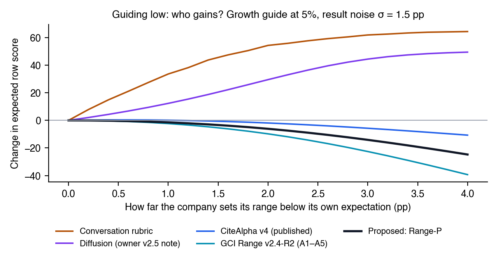
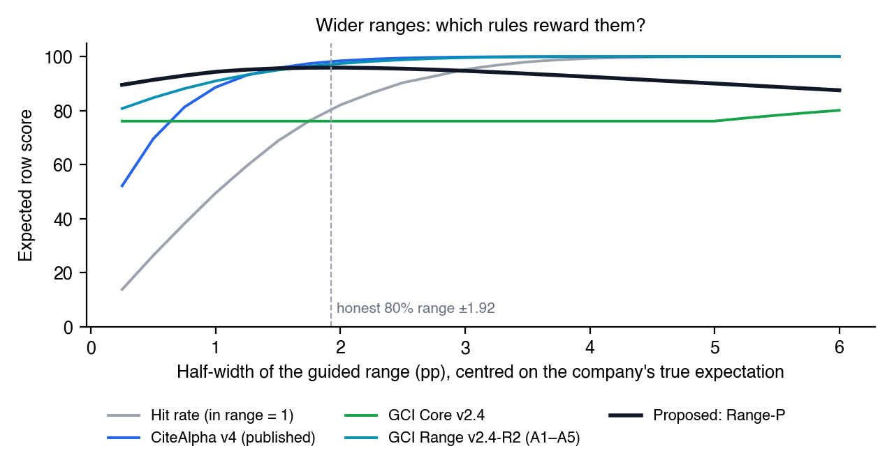
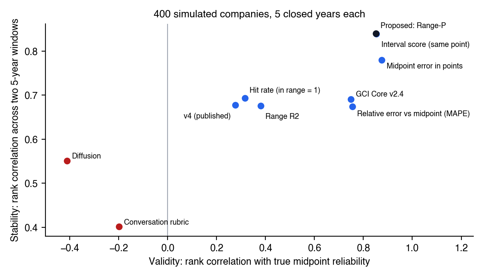
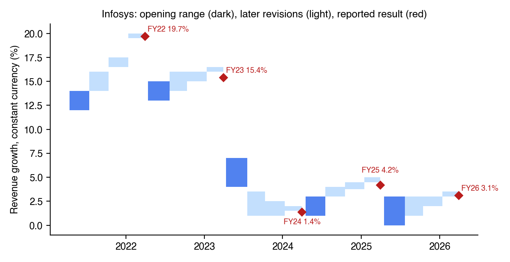

# Guidance Credibility Index — the best scoring algorithm, and how 32 products score guidance today

**To:** Product owner / Methodology owner · **From:** Tech team · **Date:** 12 Nov 2026

**Status:** Research only. Nothing is built and no published level moves. The recommended
method enters as a shadow ruleset. It can replace the published v4 only through change control:
gate 8 impact table, calibration (CAL-R2-01), owner ruling, two-person publication, ledger rows
and a same-day changelog entry (rule `index-integrity`).

**Companion paper:** `GCI_Philosophy_Actors_Parameters_Research_12_Nov_2026.md` (philosophy,
actors, parameters). This paper picks the algorithm and surveys the market.

## Summary

- **Recommendation: score each guided row with a proper range score, then publish one level per
  company.** We call the candidate *GCI Range-P* (P for proper).
  - Per row: `score = clip(100 − c × (0.1 × width + distance outside the range − allowance), 0, 100)`.
  - Units are percentage points for growth rates and margins, and per cent of the guided
    midpoint for amounts.
  - The opening guidance for the period is scored; later revisions feed *Revision Discipline*.
  - Rows roll up with a 3-year calendar half-life and evidence weights `min(n, 5)`, as today.
  - The level is shown with its confidence tier and an 80% uncertainty band.
  - Direction (beats against misses) moves out of the headline into a *Guidance Bias* companion.
- **Why this rule.** We ran ten candidate rules against the same tests (section 4). Range-P and
  the plain interval score (Gneiting and Raftery, 2007) were the only rules that:
  - give **no reward for guiding low** (gain 0.0 points);
  - give **no reward for wider ranges** (expected score peaks at ±2.0 pp against an honest ±1.92);
  - treat a **1 pp miss the same** whether growth was guided at 2% or 20%;
  - rank 400 simulated companies by their **true reliability** best among range-aware rules
    (rank correlation 0.85), and **most stably** across two independent five-year windows (0.84).
  - By comparison, the published v4 rewards wider ranges and scores 0.28 on validity. The
    conversation's rubric rewards guiding low by up to +64 points and the diffusion rule by up
    to +49; both rank companies backwards (−0.20 and −0.41).
- **What it does to a real record.** Infosys revenue guidance, FY22–FY26, opening ranges:
  - Range-P rows: 28.8 / 95.0 / 66.2 / 85.0 / 97.5. Metric level 80.0 ± 11.3.
  - The published v4 level is 76.5. This is an illustration, not a change.
  - Every Infosys opening range missed, so the hit-rate rule used by most tracker products
    scores all five years zero, including FY26 (guided 0–3%, delivered 3.1%).
- **Never score the last revision.** On Infosys FY22, the April range was 12–14%, the actual was
  19.7%, and the January range was 19.5–20%. Scored on the final range, FY22 is a perfect 100.
  A ten-year Japanese study finds the same effect at market scale:
  - Final company forecasts look 4× more accurate than opening ones (0.22 against 0.84 of a
    naive forecast's error).
  - But 94% of the final forecasts behind that apparent accuracy were disclosed after the
    period had already ended.
  - Marvin Labs scores the final guided figure; Trend & Ticker scores the last range before
    period end.
- **Market scan (section 2): 32 products and studies.**
  - **What the products do.**
    - 19 compare a company's guidance with its outcomes (17 products, 2 studies).
    - 8 sell guidance data, alerts or summaries without that comparison.
    - 5 are analyst-accuracy methods, the closest algorithmic analogue.
  - **How they score.**
    - Most count results above, within or below the guided range, sometimes with a ±1% or rounding tolerance.
    - Marvin Labs adds magnitude and materiality weights, but does not disclose the formula.
    - Bloomberg's GUID function is the only statistical treatment we found: bias-corrected guidance with confidence intervals.
    - None discloses a scoring rule that is proper for ranges.
- **India is no longer whitespace.** Four products already work on Indian management guidance:
  - **Inve:** 24,328 commitments from 1,648 companies, a 57.8% kept rate, and an A–F trust grade.
  - **Tijori:** management consistency check and Management Credibility Report.
  - **stockKYC:** Forward Signals checked against reported numbers.
  - **Arthneeti:** quarter-on-quarter management scorecard.
  - `docs/COMPETITIVE_LANDSCAPE.md` is out of date on this point.
- **CiteAlpha's defensible difference is method and governance:**
  - the filed actual, not the next call;
  - dual citation per row;
  - a disclosed proper scoring rule;
  - an append-only score ledger and public changelog;
  - a reviewer stamp.

## 1. Scope and method

1. **Market scan.** We searched for products, datasets and studies that score, rank or track
   management guidance against outcomes, in the US, UK, India and Japan. For each, we recorded
   what it scores and how, from the vendor's own documentation where possible. We mark a method
   as *disclosed* (formula published), *described* (rules in words, weights not published) or
   *undisclosed*. We did not log in to paid products. Where only a description exists, we say so
   and do not infer a formula.
2. **Algorithm tournament.** We coded ten scoring rules, using the repository's own functions
   for v4, GCI Core v2.4 and GCI Range v2.4-R2 (`backend/app/services/gci_scoring.py`). We tested
   each on:
   - guiding low;
   - range width;
   - unit consistency;
   - a beat-and-miss record;
   - 400 simulated companies;
   - five real Infosys rows with full revision chains from the hand-labelled store.
   - Scripts are in `docs/review/assets/gci_algorithm/repro/`.
3. **Specification.** The winning rule is written out as a method an index committee could adopt
   (section 5), with the parameters that still need calibration marked.

## 2. Market scan: who scores guidance, and how

### 2.1 Products and studies

Disclosure: **D** = formula disclosed; **R** = rules described in words, weights not published;
**U** = undisclosed. Coverage figures are the vendor's own, on the date we read them.

| # | Product (country) | What it scores | Method as published | Disc. |
|---|---|---|---|---|
| 1 | Marvin Labs, Guidance Scorecard (US, global) | Two 1–5 scores per company: Accuracy and Discipline | Each commitment graded beat / met / missed against the *final* guided figure. Met = inside the range or within about 1% of a point. Accuracy = how surprised a holder of the latest guidance would have been; a large beat counts like a large miss, as does a revision outside the earlier range; weighted by size and materiality (revenue, EPS, operating profit, cash flow, flagship events). Discipline = guidance carried forward; dropped or withdrawn guidance lowers it. Last 5 reporting cycles by default; as-of date supported. Cites Baik, Farber and Lee (2011). | R |
| 2 | FinCatch (US) | Per-item outcome class and a track record | Five buckets: significantly missed, missed, met, exceeded, significantly exceeded. Patterns named: conservative guiding, optimistic drift, item-specific reliability, regime change. Bucket thresholds not published. | R |
| 3 | Daloopa, guidance-tracker skill (US) | Beat rate, average beat/miss, credibility verdict | Guidance from call N against the actual in period N+1. Beat/miss % = (actual − guidance) / abs(guidance) × 100. In-line if within ±1%. A very high beat rate is read as "a floor, not a forecast". | D |
| 4 | Trend & Ticker (US) | Above / within / below range; median surprise | Last range given before the period ended, for GAAP revenue and diluted EPS, against XBRL actuals in the 10-Q or 10-K. Rounding tolerance $0.5m or half a cent. Median distance from range midpoint, in %. Needs 3 periods. 196 companies, 857 periods: 58% above, 28% within, 13% below; median +2.0%. | D |
| 5 | CycleWatch (US) | Above / inside / below range; pattern labels | Numeric guidance from earnings releases; point guidance reported apart. "Tends to exceed midpoint" if above in at least 75% of comparisons with positive median; "close to midpoint" if median within 1% (0.2 pt for margins). Needs 4 comparisons. 13,282 statements from 1,952 companies; two independent automated readers. | D |
| 6 | Stock Atlas (US) | Above / in range / below | 252,532 guided figures from 8-K releases since 2008, every revision kept. 11,138 scored figures from 1,687 companies: 52% above, 23% in range, 25% below. | D |
| 7 | Canli Capital, `guidance_record` (US) | Above / within / below; point guides apart | Each guide against the next release, matching measure, basis and unit. S&P 500 study, companies with 4 or more guided quarters: revenue ranges 49.9% above, 46.3% within, 3.8% below. | D |
| 8 | Regards of Wallstreet (US) | Share of scored metrics landing inside or above the guide | Guidance against the reported figure (41 of 43 cleared). Small sample; method page brief. | R |
| 9 | Bloomberg, GUID function (global) | Guidance quality measure; bias-adjusted guidance with confidence intervals | "Guidance quality measures are based on the statistical analysis of a company-measure's historical performance … corrected for possible bias." Model not published. Source is a Bloomberg function guide; current version not re-checked. | U |
| 10 | AlphaSense, Canalyst models Guidance tab (global) | Absolute and relative difference of actual to guidance | Low / mid / high, actual or estimate, date given, link to source file. No score. | D |
| 11 | Inve, Promise Tracker (India) | Verdict per commitment; kept rate; trust score 0–100, grade A–F | Commitments extracted from concall transcripts; later calls assign one of twelve states. Kept = achieved + achieved-diluted + revised-up + on-track, over resolvable commitments. Verdicts rest on later calls, not filed financials. 24,328 commitments, 1,648 companies, 8,220 transcripts; 57.8% kept of 16,842 resolvable; 2,271 "ghosted" (13.5% of resolvable). Trust-score formula not published. | R |
| 12 | stockKYC, Forward Signals (India) | Seven guidance themes per company, scored and checked against reported numbers | AI-assisted; quotes and dates kept; figures checked by code; sections that fail checks are withheld. Scoring weights not published. Also an AI "Management Integrity" section. | U |
| 13 | Tijori, Concall Monitor and Management Credibility Report (India) | Consistency check (said earlier vs says now); track record Met / Borderline / Missed | AI comparison of current and historical calls; report compares what management said with what it did. Thresholds not published. Zerodha-backed; on Kite. | U |
| 14 | Arthneeti (India) | Quarter-on-quarter management scorecard; banded guidance | Fixed research questions for 1,500+ companies; each quarter compared with the previous quarter's guidance. Revenue outlook banded strong / good / moderate / slow / decline. | R |
| 15 | Investegate, Corporate Credibility Index (UK) | Five-area framework | Guidance delivery, strategic consistency, communication quality, capital allocation, execution record. No formula or data. | R |
| 16 | KabuBase (Japan) | Over- and under-run ranking against the company forecast | Progress rate = cumulative actual ÷ full-year company forecast, compared with the same quarter last year to project the full year; ranked by deviation from the forecast. | D |
| 17 | kabuscope (Japan) | Rule-based detection, version 0.1 | Weighted reasons, detect at 4 or more. Example: progress 15 pts above last year's same point with forecast unchanged = +2; forecast raised 10% or more = +3; cut 5% or more = −3. | D |
| 18 | jpalpha study on Zenn (Japan) | Accuracy of company forecasts, 10 years | Point-in-time revision history. Opening forecast MAE = 0.84 × naive "same as last year"; forecast at period end 0.37; final forecast 0.22, but 94% of the final forecasts behind that figure came after period end. Direction hit 55.0% against 53.3% for always guessing the most common class. | D |
| 19 | QUICK Forecast evaluation (Japan) | Deviation of company guidance and QUICK forecast from actual | Uses company guidance *announced at the beginning of the fiscal year*, against actual; deviation rates by year. | D |
| 20 | LSEG I/B/E/S Guidance (global) | Guidance relative to consensus: exceeds / meets / misses | 9,500+ active companies, 15,000 historical; 20 comparable and 110 as-reported measures; history from 1994 (US), 2003 (rest of world). Compares guidance with consensus, not with the actual. | D |
| 21 | FactSet Estimates, guidance (global) | Company guidance captured as a category; actual collected for guided items | Data, no credibility score. | D |
| 22 | S&P Capital IQ Estimates, company guidance (global) | Point-in-time guidance dataset | Data, no score. | D |
| 23 | Benzinga Guidance API (US) | Current and prior EPS and revenue ranges; importance 0–5 | Raised / lowered can be derived from prior range. No score. | D |
| 24 | Hudson Labs (US) | Hard and soft guidance extraction; who is revising | Separates numeric ranges from qualitative guidance; forensic risk scores. No credibility score published. | R |
| 25 | Kepler (US) | Guidance change alerts | New statement beside the prior one, with transcript link. No score. | D |
| 26 | guidance.fyi (India) | Verified concall summaries, guidance items | Every displayed number must appear in the filed transcript; a second model audits context. No delivery scoring. | D |
| 27 | AlphaSense, Smart Summaries (global) | Guidance summary per call, cited | Generative summaries with citations. No score. | D |
| 28 | StarMine SmartEstimate (LSEG) | Analyst-accuracy-weighted consensus; Predicted Surprise | Weights analysts by historical accuracy (1–5 stars) and recency; drops estimates older than 120 days and those left behind by a revision cluster. Predicted Surprise beyond ±2% is directionally right about 70% of the time (revenue 78%). The most accurate analysts are about 4× as likely to stay most accurate as to drop to least accurate. | R |
| 29 | Zacks, Most Accurate Estimate and ESP (US) | Accuracy- and recency-weighted EPS forecast | Expected Surprise Prediction = % gap between Most Accurate Estimate and consensus. | R |
| 30 | Estimize (US) | Crowd consensus weighted by recency and confidence | Reports being more accurate than Wall Street 74% of the time. | R |
| 31 | Earnings Whispers (US) | Whisper number | Closer to the actual than published consensus 69.7% of the time (144,000+ numbers). | U |
| 32 | Visible Alpha (global) | Line-item consensus, dispersion, revisions | Sell-side model data; no guidance score. | D |

Also reviewed, with guidance summaries but no scoring we could find: Quartr, Aiera, Fiscal.ai,
Trendlyne, Screener, StockInsights.ai, Multibagg.

**Academic measures.**

- Baik, Farber and Lee (2011) measure management forecast accuracy as the absolute difference
  between forecast and actual EPS, scaled by share price.
- Hutton and Stocken (2021) find investors react more to forecasts from managers with more
  accurate past forecasts. The reputation effect is the reason a credibility index has value.
- Gneiting and Raftery (2007) define the interval score for ranges. Range-P is built on it.

### 2.2 The six method families

| Family | Who | How a row is scored | Main weakness |
|---|---|---|---|
| Categorical count | Trend & Ticker, CycleWatch, Stock Atlas, Canli, Daloopa, FinCatch, Marvin (grading step), I/B/E/S (vs consensus) | Above / within / below, sometimes ±1% or rounding tolerance | Cliff at the range edge; wider ranges always help; magnitude lost |
| Magnitude-weighted judgment | Marvin Labs (Accuracy), Tijori | Surprise size and materiality, rolled into a 1–5 or Met / Borderline / Missed | Weights not published, so the score cannot be recomputed |
| Statistical bias correction | Bloomberg GUID, FinCatch (historical bias adjustment), StarMine (analyst side) | Error history estimates a bias and a spread | Model not published (Bloomberg); predicts estimates rather than grading a record |
| Verdict ledger from later calls | Inve, Arthneeti, Tijori | Later call says achieved / on track / missed / silent | Management grades itself; filed financials not used |
| AI-assisted signal scoring | stockKYC, Tijori reports | Model reads and scores, code checks figures | Undisclosed weighting; re-runs can differ |
| Qualitative framework | Investegate | Five areas scored by the reader | No data, no formula |

### 2.3 Lessons for a citable index

1. **Score the opening guidance; never the final revision.**
   - The Japanese study shows final forecasts are mostly reporting rather than forecasting, and QUICK measures from the opening guidance.
   - Marvin Labs scores the final guided figure; Trend & Ticker the last range before period end.
   - Our Infosys rows show the size of the effect (section 5.4).
2. **Count beats as error, and report direction separately.**
   - Marvin Labs is explicit: "guidance routinely beaten by a wide margin tells you as little as guidance that is missed."
   - US tracker data shows how common beating is:
     - Trend & Ticker: 58% above the range, 13% below.
     - Canli: revenue below the range only 3.8% of the time.
   - A score that rewards beats rewards guiding low.
3. **Separate delivery from continuity.**
   - Marvin's Discipline score and Inve's "ghosted" commitments (2,271; 60.7% of companies have at least one) measure dropped guidance.
   - That is a different question from accuracy, and it belongs in a companion score, not the headline.
4. **Use filed actuals.**
   - Inve's verdicts rest on later calls, so management grades itself.
   - Trend & Ticker and CycleWatch read the filed numbers.
   - CiteAlpha's dual citation (guidance quote and filed actual) is the stronger evidence standard.
5. **Measure against a naive baseline.**
   - In Japan, opening forecasts beat "same as last year" by only 16%.
   - Direction calls beat the trivial guess by 1.7 points.
   - Without a baseline, an accuracy number has no meaning. This motivates the *Guidance Informativeness* companion (section 5.6).
6. **Accuracy persists, which is what makes a record worth publishing.**
   - StarMine reports that the most accurate analysts are about 4× as likely to stay most accurate as to drop to least accurate.
   - A good index rule should therefore produce stable rankings across windows. We test this.
7. **Publish the formula.**
   - Of the products that score a company record, only the simple counts disclose their full rule.
   - Every weighted or AI-judged score is opaque.
   - An index level that a client cannot recompute from the cited rows is not citable.

## 3. What the best algorithm must do

| # | Requirement | Test in section 4 |
|---|---|---|
| R1 | No reward for setting guidance below the company's own expectation | Gain from guiding low |
| R2 | No reward for a range wider than the company's honest uncertainty | Width at which the expected score peaks |
| R3 | Error measured in the unit the guidance is given in: pp for rates and margins, per cent for amounts | 1 pp miss at 2% guided growth against 20% |
| R4 | No cliff at the range edge; a 0.1 pp miss scores near a hit | Infosys FY26 (0–3% → 3.1%) |
| R5 | Beats and misses do not cancel | Alternating ±3 pp against steady +0.5 pp |
| R6 | Ranks companies by true reliability | Rank correlation with simulated truth |
| R7 | Rankings persist across independent windows | Rank correlation across two windows |
| R8 | One published level per company; profile weightings stay in the Workbench | Design |
| R9 | Recomputable from the cited rows with a published formula | Design |
| R10 | Never scores information that arrived after the period ended | Vintage policy |

## 4. Algorithm tournament

### 4.1 Candidates

| Rule | Row score (growth row, guided range L–U, actual A, midpoint m) |
|---|---|
| Hit rate | 100 if A inside the range, else 0 (most tracker products) |
| Conversation rubric | Relative error to midpoint with a 1% band, beat bonus, miss penalty to −100 (paper 1) |
| Relative error (MAPE) | 100 × (1 − abs(A − m) / abs(m)), floor 0 |
| Diffusion | 50 + 50 × clamp((A − m) / abs(m), −1, 1) (owner's v2.5 note) |
| CiteAlpha v4 (published) | `outcome_score_v4`: band half-width, beat floor 60, miss decay γ = 1.4 |
| GCI Core v2.4 | `core_vintage_z`: z = abs(A − m) / half the sum of bound magnitudes; score 100 (1 − z) |
| GCI Range v2.4-R2 | `r2_vintage_terms`: z = distance to nearest bound / max(width, abs(m), 5 pp floor) |
| Midpoint error in points | 100 − 12.5 × abs(A − m) in pp |
| Interval score (linear) | 100 − 12.5 × (0.1 × width + distance outside) |
| **Range-P (proposed)** | clip(100 − 12.5 × (0.1 × width + distance outside − 0.2), 0, 100) |

The 12.5 points per pp, 0.1 width charge (α = 0.2, an 80% range) and 0.2 pp allowance are
illustrative starting values for revenue growth. Section 5.3 sets out how to calibrate them.

### 4.2 Set-up

- **Guiding low and width.**
  - The company's true expected growth is 5%. The result is normal around it with σ = 1.5 pp. The honest 80% range is ±1.92 pp.
  - To test guiding low, we shift that range down by 0–4 pp.
  - To test width, we centre the range and vary its half-width from 0.25 to 6 pp.
  - Each point is the mean of 3,000–4,000 draws.
- **Validity and stability.**
  - **Companies.** 400 simulated companies, each with its own noise σ uniform between 0.5 and 3 pp. Half guide honestly; half set the range low by up to 2σ. Range width is 0.4–2.5 times the honest width.
  - **Records.** Expected growth each year is uniform between 1% and 15%. Two independent five-year records per company.
  - **True reliability.** Root-mean-square distance of the result from the guided midpoint: how far an investor taking the guidance at face value would have been off.
  - **Validity.** Rank correlation of each rule's company level with that truth.
  - **Stability.** Rank correlation between the two windows.
- **Real rows.** Infosys revenue growth in constant currency, FY22–FY26, opening ranges against
  filed actuals, from the hand-labelled store.

### 4.3 Results

| Rule | Gain from guiding low (pts) | Width that maximises the score | Validity | Stability | 1 pp miss at 2% / at 20% | Alternating / steady | Infosys FY26 |
|---|---|---|---|---|---|---|---|
| Hit rate | 0.0 | widest tested (±5.25+) | 0.32 | 0.69 | 0 / 0 | 0 / 0 | 0 |
| Conversation rubric | **+63.9** | ignores width | **−0.20** | 0.40 | −100 / −100 | −30 / 40 | 40 |
| Relative error (MAPE) | 0.0 | ignores width | 0.75 | 0.67 | **0 / 90** | 20 / 70 | **0** |
| Diffusion | **+49.4** | ignores width | **−0.41** | 0.55 | 0 / 45 | 50 / 65 | 100 |
| CiteAlpha v4 | +0.4 | widest tested (±5.25+) | 0.28 | 0.68 | 58.7 / 58.7 | 35 / 94.5 | 99.5 |
| GCI Core v2.4 | 0.0 | widest tested | 0.75 | 0.69 | **0 / 90** | 20 / 70 | **0** |
| GCI Range v2.4-R2 | 0.0 | widest tested (±5.25+) | 0.38 | 0.68 | 80 / 95 | 40 / 90 | 98.0 |
| Midpoint error in points | 0.0 | ignores width | **0.88** | 0.78 | 75 / 75 | 50 / 81.2 | 80.0 |
| Interval score | 0.0 | **±2.00** | 0.85 | **0.84** | 85 / 85 | 60 / 91.2 | 95.0 |
| **Range-P** | **0.0** | **±2.00** | **0.85** | **0.84** | **87.5 / 87.5** | **62.5 / 93.8** | **97.5** |







### 4.4 Reading the results

- **Signed rules rank companies backwards.**
  - The conversation's rubric and the diffusion rule both pay for results above the guide.
  - So a company that guides low scores higher than one that guides honestly, and both correlate negatively with true reliability.
  - They can serve as a *Guidance Bias* reading, never as the level.
- **Relative error fails near zero growth.**
  - MAPE and GCI Core v2.4 divide by the guided midpoint. A 1 pp miss on 2% guided growth scores 0; the same miss on 20% scores 90.
  - Both score Infosys FY25 and FY26 at 0. This was the reason for R2.
- **v4, R2 and the hit rate pay for width.**
  - Their expected score keeps rising past the honest width (figure 2). Wider ranges contain more results and shrink the scaled distance.
  - The *Guidance Setting* companion flags wide ranges, but the headline still rewards them.
- **v4 barely rewards guiding low in this set-up.** It pays +0.4 points, and its beat floor of
  60 is the source. The size depends on the set-up: paper 1, measuring in band widths, found
  +2.5.
- **Midpoint error has the best validity score but cannot see the range.**
  - Its 0.88 partly reflects how we defined truth (distance from midpoint).
  - It scores "0–30%" exactly like a point guide of 15%, so it gives no credit for a tight, honest range.
- **Interval score and Range-P are the only rules that meet R1–R7 together.**
  - Range-P differs only in the allowance and the cap. A typical-width range that contains the result scores 100, which is what a reader expects of "met".
  - The cap removes any reward for ranges narrower than typical, and costs nothing in validity or stability here.

**Limits of the test.**

- The companies are simulated, with normal errors and one noise level per company.
- The truth measure favours midpoint-based rules.
- The slope and allowance are illustrative.
- The real-data check is one company.

These limits matter for calibration, not for the ranking of rules. The properness results
(R1, R2) follow from the mathematics of the interval score and hold for any noise level.

## 5. Recommended algorithm: GCI Range-P

### 5.1 Measurement unit per row

| Metric family | Unit of L, U, A | Example |
|---|---|---|
| Growth rates (revenue, volume, loan book, AUM) | percentage points | Infosys revenue growth cc: 0–3% against 3.1% → distance 0.1 pp |
| Margins and ratios (EBITDA margin, ROA, credit cost, NIM) | percentage points (bps ÷ 100) | Cipla EBITDA margin 21.5–22.5% against 24.5% → 2.0 pp |
| Amounts (capex ₹ cr, order inflow, units) | per cent of guided midpoint | Capex ₹10,000 cr guided, ₹9,200 cr spent → 8 points |
| Counts and capacity (stores, MW, plants) | per cent of guided midpoint | — |
| Dates (launches, commissioning) | not in the headline; *Commitment Delivery* (days late) | — |
| Qualitative guidance | not in the headline; Qual branch (`services/commitments.py`) | — |

Amounts whose guided midpoint is within ±2% of zero (for example near-breakeven profit) are
scored in points of revenue instead, or left as context. They are never divided by a midpoint
near zero.

### 5.2 Row score

For one guided metric, one period, the opening vintage:

```
W  = U − L                                   (0 for point guidance)
D  = max(0, L − A) + max(0, A − U)           (distance outside the range)
P  = (α/2) · W + D                           (interval-score penalty, α = 0.2 → 80% range)
S  = clip(100 − c_f · (P − a_f), 0, 100)     (row score)

c_f = points per unit for family f           (growth, illustrative: 12.5 per pp)
a_f = (α/2) · W_typ,f                        (allowance; growth, illustrative: 0.1 × 2 pp = 0.2)

Floor only ("at least L"):
    P = (α/2) · max(0, A − L) + (1 − α/2) · max(0, L − A)
Ceiling only ("at most U"):
    P = (α/2) · max(0, U − A) + (1 − α/2) · max(0, A − U)
```

- **Why it is proper.** P is the sum of two quantile (pinball) losses at the 10th and 90th
  percentiles. Its expected value is lowest when the company states its honest 10th and 90th
  percentiles, so neither shifting the range nor widening it helps. A linear map keeps that
  property. The clip at 0 (very large misses) and 100 (narrower than typical) are the only
  departures, and the simulation shows they do not move the optimum (figure 2).
- **What "met" means.** A result inside a range of typical width scores 100. A wider range that
  contains the result scores a little less: 1.25 points per pp of width beyond typical. A miss
  costs 12.5 points per pp in the illustrative growth calibration.
- **One-sided bounds.** A floor ("at least 20%") is read as the company's 10th percentile.
  Each point below it adds 0.9 to the penalty; each point above it adds 0.1. A floor set far
  too low therefore loses a little, not nothing.
- **Point guidance.** W = 0, so there is no width charge, but the expected distance is larger.
  In simulation, an honest 80% range scores at least as well as a point guide at every noise
  level tested (0.1–1.5 pp); at σ = 1.5 pp it scores 95.9 against 87.5.

### 5.3 Calibration (CAL-R2-01)

| Parameter | Role | Starting value | How to set it |
|---|---|---|---|
| α | Nominal coverage of a guided range | 0.2 (80%) | Fixed by the committee and published; not fitted |
| W_typ,f | Typical width per family | growth 2 pp | Median opening-range width in the family across the hand-labelled universe |
| c_f | Points per unit per family | growth 12.5 per pp | Set so the family's 90th-percentile penalty P scores 25 |
| h | Recency half-life | 3 years (5 for banks and cyclicals) | Committee choice, as in paper 1 |

Calibration runs on closed hand-labelled rows only. It is frozen per `dataset_version`, and any
recalibration is a methodology change with ledger rows and a changelog entry.

### 5.4 Which guidance is scored

| Vintage policy | Infosys FY22 | FY23 | FY24 | FY25 | FY26 | Used by |
|---|---|---|---|---|---|---|
| Opening range (**recommended for the level**) | 28.8 | 95.0 | 66.2 | 85.0 | 97.5 | QUICK; CiteAlpha v4 today |
| Exposure-weighted (each range weighted by the days it was live) | 62.7 | 97.3 | 90.5 | 95.3 | 99.0 | — |
| Final range before period end | **100.0** | 94.4 | **100.0** | 98.1 | **100.0** | Marvin Labs, Trend & Ticker |
| Revisions outside the prior range | 2 | 0 | 1 | 0 | 0 | Marvin Labs (counted in Accuracy) |



- **The level scores the opening range,** the promise investors priced at the start of the year.
- **Revisions are a separate record.**
  - *Revision Discipline* already exists. It gains a count of revisions that left the prior range (Infosys FY22: 2; FY24: 1) and the date of each.
  - *Guidance Visibility* already rewards early warning.
- **The exposure-weighted reading is a Workbench diagnostic, not the level.** It answers a different question: how useful the guidance was over the year.
- **Ranges issued after the period ended are never scored.**

### 5.5 Company level

```
per metric k:   M_k = Σ_t w_t · S_k,t / Σ_t w_t,      w_t = 2^(−age_t / h)
headline set:   metrics with at least 2 closed periods (1 closed period = context, as today)
level:          GCI = Σ_k e_k · M_k / Σ_k e_k,       e_k = min(n_k, 5)
band (n ≥ 3):   ± 1.28 · sqrt( Σ_t (w_t / Σ w)² · (S_k,t − M_k)² )   shown beside the tier
```

Infosys, as of 23 Apr 2026, revenue rows only (FY24 operating margin is context):

| Period | Opening range | Reported | Range-P | Weight (h = 3 years) |
|---|---|---|---|---|
| FY22 | 12–14% | 19.7% | 28.8 | 0.394 |
| FY23 | 13–15% | 15.4% | 95.0 | 0.497 |
| FY24 | 4–7% | 1.4% | 66.2 | 0.628 |
| FY25 | 1–3% | 4.2% | 85.0 | 0.791 |
| FY26 | 0–3% | 3.1% | 97.5 | 1.000 |
| **Level** | | | **80.0 ± 11.3** | |

The published v4 level is 76.5 (tier: deep). The two numbers are not comparable as a change.
Range-P would publish only after calibration and the gate-8 impact table.

### 5.6 Companions (published beside the level, never blended into it)

| Companion | Question | Formula | Infosys revenue (illustration) | Owner |
|---|---|---|---|---|
| Guidance Bias | Do results land above or below the guide? | Weighted mean of (A − m), in family units | +1.2 pp; results above midpoint in 4 of 5 years | `guidance_profile.py` (proposed) |
| Range Honesty | Do stated ranges contain the results as often as an 80% range should? | Share of results inside the opening range, against 80% | 0 of 5 inside | `guidance_profile.py` (proposed) |
| Guidance Informativeness | Is the guide better than "same as last year"? | 1 − MAE(midpoint) / MAE(naive) | 0.58 (guide error 2.33 pp, naive 5.55 pp; FY23–FY26) | `guidance_profile.py` (new) |
| Revision Discipline | How and when did guidance move? | Existing, plus revisions outside the prior range | FY22: 2, FY24: 1 | `guidance_profile.py` (exists) |
| Guidance Visibility | Was the warning early? | Existing | — | exists |
| Commitment Delivery | Were dated milestones met? | Existing (days late) | — | exists |
| Guidance Continuity | Was guidance carried forward or dropped? | Share of guided metrics re-guided next period; drops and withdrawals listed | — | `guidance_profile.py` with `guidance_flags.py` (new) |

Two existing companions become redundant once Range-P is the level:

- *Growth Accuracy* duplicates the pp unit.
- *Guidance Setting* duplicates the width charge.

They stay as diagnostics until the gate decision, then retire with a changelog entry.

Profile and sector weightings (investor lenses) stay in the Analyst Workbench. They never change
the published level (paper 1, section 7).

### 5.7 Pseudocode

```python
def range_p_row(fam, low, high, actual, *, bound=None, alpha=0.2):
    L, U, A = to_family_units(fam, low, high, actual)        # pp, or % of midpoint
    if bound == "floor":
        P = alpha/2 * max(0, A - L) + (1 - alpha/2) * max(0, L - A)
    elif bound == "ceiling":
        P = alpha/2 * max(0, U - A) + (1 - alpha/2) * max(0, A - U)
    else:
        P = alpha/2 * (U - L) + max(0, L - A) + max(0, A - U)
    a = alpha/2 * CAL[fam].typical_width
    return min(100.0, max(0.0, 100 - CAL[fam].points_per_unit * (P - a)))

def company_level(rows, as_of, half_life):
    by_metric = group(rows, key="metric", only=opening_vintage, closed=True, dual_cited=True)
    levels = {k: weighted_mean([(range_p_row(*r.args), 2 ** (-age(r, as_of) / half_life)) for r in rs])
              for k, rs in by_metric.items() if len(rs) >= 2}
    return weighted_mean([(lvl, min(len(by_metric[k]), 5)) for k, lvl in levels.items()])
```

`to_family_units`, `CAL` and `opening_vintage` are named here for clarity. They would be built on the existing
row model and score policy, not as a parallel stack: `GuidanceOutcome`, `score_policy.excluded_from_score`, and
the `ruleset` switch in `compute_core_detail`.

## 6. How Range-P compares with the market

| Dimension | Range-P (proposed) | Marvin Labs | Inve | Trend & Ticker / CycleWatch | Bloomberg GUID |
|---|---|---|---|---|---|
| Evidence for the actual | Filed results, cited | Filings, web as last resort | Later calls | XBRL filings | Bloomberg data |
| Evidence for the promise | Cited quote and date | Cited | Quote and speaker | Earnings release | Bloomberg guidance |
| Which guidance is scored | Opening range | Final guided figure | Target as stated; verdict from the latest call | Last range before period end (Trend & Ticker) | Not published |
| Range treatment | Proper interval score | Inside range or about 1% | Verdict | Inside / outside, rounding tolerance | Confidence interval |
| Beats | Count as error; direction in Guidance Bias | Count as error | Kept | Counted as "above" | Bias-corrected |
| Reward for guiding low or wide | None (tested) | Not testable (weights unpublished) | Not applicable | Wider always helps | Not published |
| Formula published | Yes | No | Partly (kept rate yes, trust score no) | Yes | No |
| Governance | Ledger, changelog, reviewer stamp, tier | Not stated | Not stated | Accuracy audit page | Not stated |
| Market | India first | US, global | India, US | US | Global |

## 7. Rollout and governance

1. **Shadow (no public change).**
   - Add `range_p` as a `ruleset` value in `compute_core_detail`, using the existing row model and dual-citation filter.
   - Add four companions to `guidance_profile.py`: Guidance Bias, Range Honesty, Guidance Informativeness and Guidance Continuity.
   - Tests:
     - A properness test: gain from guiding low under 0.5 points; expected-score peak within 10% of the honest width.
     - A unit-consistency test.
     - Real-row fixtures for Infosys and Cipla.
     - The existing `tests/test_score_consistency.py` and synthetic-leak tests.
2. **Calibration (CAL-R2-01).** Fit W_typ and c per family on closed hand-labelled rows; freeze
   with the dataset version.
3. **Gate 8 impact table.**
   - Show every published name under v4 and Range-P side by side, with row-level reasons for each move.
   - Include the vintage-policy table (section 5.4) for each name with revisions.
4. **Owner ruling, then two-person publication.**
   - Ledger rows `(company_id, as_of, algorithm_id, dataset_version, gci, confidence_tier, reason="methodology")`.
   - Methodology changelog and public `/changelog` the same day, with before and after.

### Decisions for the owner

| # | Decision | Recommendation |
|---|---|---|
| D-A | Headline symmetric (beats count as error) with direction in Guidance Bias | Adopt. Any beat-forgiving asymmetry re-creates the reward for guiding low |
| D-B | Opening range as the scored vintage | Adopt; revisions to Revision Discipline |
| D-C | α = 0.2 as the published nominal coverage | Adopt |
| D-D | Calibration rule for c and W_typ | Adopt the 90th-percentile-scores-25 rule, or set a fixed points-per-pp by family |
| D-E | Add Guidance Informativeness and Guidance Continuity; retire Growth Accuracy and Guidance Setting after the gate | Adopt |
| D-F | Public name | Keep "GCI". "Range-P" is a working name only |

## 8. Risks and open questions

- **"Beating guidance is good."**
  - Some readers will object that a large beat lowers the level.
  - The answer: the GCI measures how reliable guidance is as information. A 5.7 pp beat (Infosys FY22) left investors as far from the outcome as a 5.7 pp miss would have. Guidance Bias shows the direction in one line.
  - Copy for the dossier: "Results landed above the guided range in 4 of 5 years; the level measures distance from the guide in either direction."
- **Implied coverage.** Indian companies do not state what probability their range covers. α is our convention, published, not their claim.
- **Small samples.** Most companies have 2–5 closed periods per metric. The uncertainty band and the tier carry that; the level is not shrunk toward a prior.
- **Family scales need data.** Margins and amounts have few labelled rows today. Until a family has enough rows to calibrate, its rows stay context-only.
- **Competitive overlap.** Inve, Tijori and stockKYC already reach Indian retail and Kite users. CiteAlpha's advantages are the filed-actual evidence standard, a published proper rule, and index governance. These are worth stating on the methodology page.

## Appendix A. Formulas

- Interval score (Gneiting and Raftery, 2007), range [L, U] at level 1 − α, result x:
  `IS = (U − L) + (2/α)·max(0, L − x) + (2/α)·max(0, x − U)`.
  Range-P penalty `P = (α/2)·IS`.
- Pinball loss at quantile τ for bound q: `ρ_τ(q, x) = τ·max(0, x − q) + (1 − τ)·max(0, q − x)`.
  P = ρ_{α/2}(L, x) + ρ_{1−α/2}(U, x).
- Guidance Informativeness: `1 − mean(abs(A_t − m_t)) / mean(abs(A_t − A_{t−1}))`, at least 3 pairs.
- Baik, Farber and Lee (2011) accuracy: `abs(F − A) / price`.

## Appendix B. Reproduction

Scripts in `docs/review/assets/gci_algorithm/repro/`:

- `rules.py`: the ten rules; v4, Core v2.4 and R2 call `gci_scoring.py`.
- `tournament.py` and `tournament2.py`: section 4.3.
- `vintages.py`: section 5.4.
- `curves.py` and `charts_sys.py`: figures.

Run the rule scripts with `backend/.venv/bin/python` and the chart script with a Python that
has matplotlib. Seeds are fixed. Infosys rows are the hand-labelled rows in the backend seed
store (revenue growth cc, FY22–FY26, with revision chains).

## Appendix C. Sources

**Products**

- Marvin Labs: [Guidance Scorecard docs](https://app.marvin-labs.com/docs/guidance-scorecard/), [feature page](https://www.marvin-labs.com/features/guidance-scorecard/), [Track Record agent](https://app.marvin-labs.com/docs/deep-research-agents/)
- [FinCatch](https://www.fincatch.io/blog/Management-Guidance-Extraction-and-Analysis)
- Daloopa: [skills](https://docs.daloopa.com/docs/skills), [guidance-tracker](https://skillsmp.com/creators/daloopa/investing/claude-skills-guidance-tracker)
- [Trend & Ticker](https://trendandticker.com/guidance-track-record)
- [CycleWatch](https://cyclewatch.org/guidance/)
- [Stock Atlas](https://stockatlas.com/insights/do-companies-beat-their-own-guidance/)
- [Canli Capital](https://canlicapital.com/notes/how-often-companies-beat-their-guidance)
- [Regards of Wallstreet](https://www.regardsofwallstreet.com/data/earnings-moves)
- Bloomberg GUID: [function guide copy](https://studylib.net/doc/8159115/earning-analysis--analyst-estimates-and-company)
- AlphaSense: [Canalyst models](https://help.alpha-sense.com/hc/en-us/articles/42489711231763-Canalyst-Models), [Smart Summaries](https://help.alpha-sense.com/hc/en-us/articles/41669307479443-Get-Instant-Insights-and-Save-Time-with-Smart-Summaries)
- Inve: [methodology](https://inve.money/methodology), [study](https://inve.money/blog/do-indian-companies-deliver-on-guidance), [paper](https://doi.org/10.5281/zenodo.22337300)
- stockKYC: [Forward Signals](https://stockkyc.com/research-tools/forward-signals/summary), [methodology](https://stockkyc.com/methodology)
- Tijori: [launch note](https://nithinkamath.me/blog/tijoris-ai-tools-for-market-research/), [reports](https://www.tijorifinance.com/reports/)
- Arthneeti: [methodology](https://www.arthneeti.com/methodology), [Q2 FY27 scorecard](https://www.arthneeti.com/earnings/q2-fy27/scorecard)
- [Investegate](https://www.investegate.co.uk/content/the-corporate-credibility-index)
- [KabuBase](https://kabubase.jp/fcrank)
- [kabuscope](https://kabuscope.com/about.html)
- [jpalpha study](https://zenn.dev/jpalpha/articles/df2fbfa0d89c09)
- [QUICK Forecast evaluation](https://corporate.quick.co.jp/data-factory/wp-content/themes/quickDataFactory/system/dl.php?path=%2Fvar%2Fwww%2Fhtml%2Fwp-content%2Fuploads%2FQUICKForecast.pdf)
- [LSEG I/B/E/S Guidance](https://www.lseg.com/en/data-catalogue/company-data/ibes-estimates/guidance)
- [FactSet Estimates](https://www.factset.com/marketplace/catalog/product/factset-estimates-consensus)
- [S&P Capital IQ Estimates](https://www.spglobal.com/market-intelligence/en/solutions/products/estimates)
- [Benzinga Guidance API](https://docs.benzinga.com/api-reference/calendar-api/get-guidance)
- [Hudson Labs](https://www.hudson-labs.com/products)
- [Kepler](https://kepler.ai/guides/best-ai-earnings-call-analysis/)
- [guidance.fyi](https://guidance.fyi/methodology/)
- StarMine: [SmartEstimates](https://www.lseg.com/en/data-catalogue/analytics/quantitative-analytics/starmine-smartestimates), [20 years](https://lipperalpha.refinitiv.com/2021/03/20-years-of-starmine-smartestimates-20-years-of-outperformance/)
- [Zacks](https://www.zackspro.com/models.asp)
- [Estimize](https://www.estimize.com/faq?fullsite=true)
- [Earnings Whispers](https://www.earningswhispers.com/about-whispers)
- [Visible Alpha](https://visiblealpha.com/products/consensus-estimates-for-investment-research/)

**Research**

- Baik, B., Farber, D. B. and Lee, S. (2011). CEO ability and management earnings forecasts. *Contemporary Accounting Research* 28(5), 1645–1668. [doi:10.1111/j.1911-3846.2011.01091.x](https://doi.org/10.1111/j.1911-3846.2011.01091.x)
- Hutton, A. P. and Stocken, P. C. (2021). Prior forecasting accuracy and investor reaction to management earnings forecasts. *Journal of Financial Reporting* 6(1), 87–107. [doi:10.2308/jfr-2020-005](https://doi.org/10.2308/jfr-2020-005)
- Gneiting, T. and Raftery, A. E. (2007). Strictly proper scoring rules, prediction, and estimation. *Journal of the American Statistical Association* 102(477), 359–378.
- CFOzine (2026). [Measuring forecast accuracy: bias, median absolute error, direction hit rate](https://cfozine.jp/posts/forecast-accuracy-measurement/).
