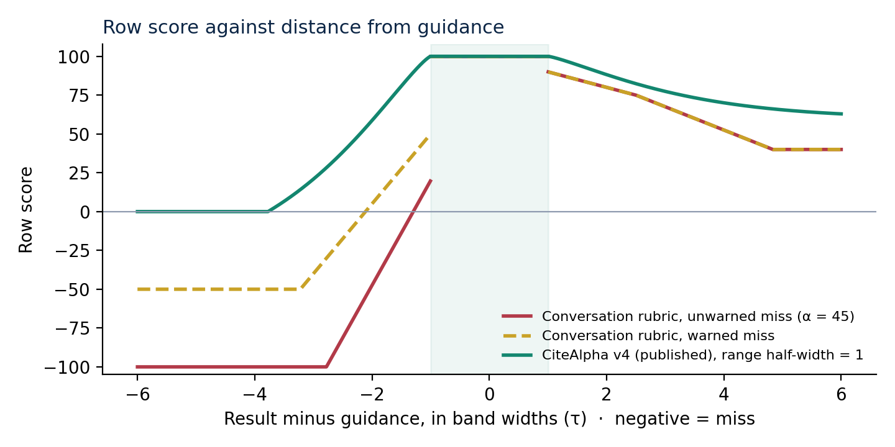
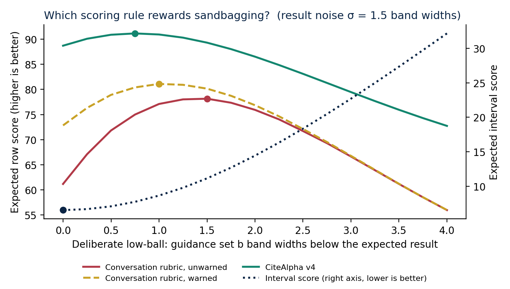
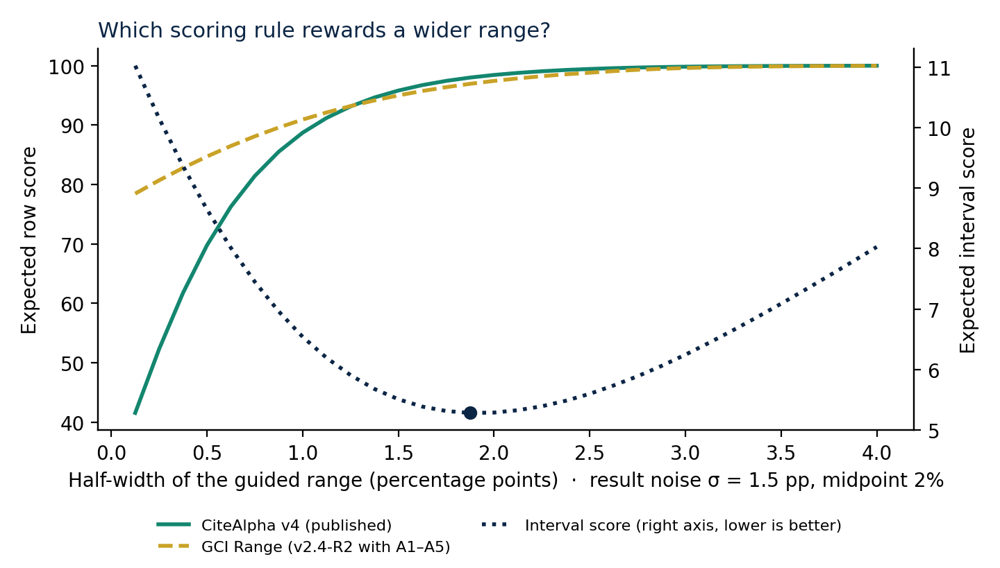
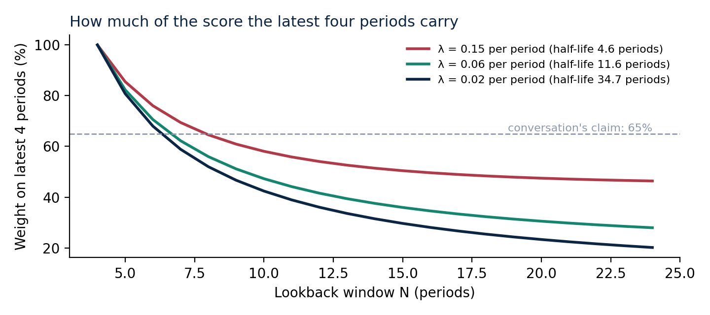

# Guidance Credibility Index — philosophy, actors, parameters and scoring: a research review

**To:** Product owner / Methodology owner · **From:** Tech team · **Date:** 12 Nov 2026

**Status:** Research only. Nothing is built and no published level moves. Any item adopted from
this paper goes through change control: impact table on gate 8, calibration (CAL-R2-01), ledger
rows and a changelog entry (rule `index-integrity`).

**Revised 14 Nov 2026:** Section 7.5 lens presets now use the companion set from
`GCI_Best_Algorithm_and_Market_Scan_12_Nov_2026.md` (section 5.6). A Sell-side estimates
preset and a lens-settings table were added, and the Stewardship preset now also serves boards.
Actors still share one scoring rule.

**What this reviews:** a four-turn external AI conversation on the philosophy of a guidance
credibility index, guidance practices around the world, rubric matrices by sector and investor
profile, and a set of scoring equations. We checked each claim against company filings,
exchange rules and the accounting-research literature. We recomputed every formula and ran
the scoring rules against simulated management behaviour. We then mapped the useful ideas
onto what CiteAlpha already ships (`docs/PLAN_GCI_CORE.md`, `docs/kb/03-scoring.md`).

## Summary

- **The philosophy in the conversation is broadly right.** Guidance is a forecast whose
  reliability can be measured. Trust should follow a dated, cited delivery record. Silent
  withdrawal of a guided metric is a governance signal. The research literature supports
  each of these points (section 3.3).
- **Its scoring equations should not be adopted.** They have five defects:
  1. **Wrong unit for growth guidance.** They measure error as a percentage of the guided
     growth rate. In the conversation's worked example, guiding 5.0% growth and delivering
     4.2% scores −100, the floor. On revenue it is a 0.76% shortfall, inside the conversation's
     own ±1% band.
  2. **They pay companies to low-ball.** With result noise of 1.5 band widths, setting guidance
     about 1.5 bands below the true expectation lifts the expected row score from 60.7 to 78.1.
     The more volatile the business, the larger the reward (up to +28 points).
  3. **Cliffs at the band edge.** A result just outside the band drops from 100 to 20.
  4. **The range is ignored.** Infosys's FY24 operating margin (guided 20–22%, reported 20.7%)
     scores −8.9 although it landed inside the range.
  5. **One score per investor profile cannot be a published index.** It breaks the
     one-level, one-ledger contract.
- **Our own scorers have smaller versions of the same problems.** The published v4 pays about
  +2.5 points for low-balling by 0.75 band widths. Both v4 and GCI Range (v2.4-R2) score
  higher the wider the guided range is. The *Guidance Setting* companion flags wide ranges,
  but the headline still rewards them (figures 2 and 4).
- **A proper scoring rule for ranges exists.** The interval score (Gneiting and Raftery, 2007)
  is lowest when management states its honest range: neither shifted down nor wider than its
  true uncertainty. We recommend testing it as a *Range Honesty* diagnostic, not as the headline.
- **Several company facts in the conversation are wrong or out of date.**
  - Unilever publishes a multi-year underlying-sales-growth range of 4–6%.
  - Apple guided its December 2026 quarter at 7–10% revenue growth.
  - Infosys cut its FY27 revenue guidance a second time on 23 Oct 2026, to 1–2% in constant
    currency.
  - Naming companies as "sandbaggers" without a measured record is a claim-hygiene risk.
- **Most of the useful ideas already have an owner in CiteAlpha:**
  - Revisions sit in *Revision Discipline*.
  - Timeliness sits in *Guidance Visibility*.
  - Milestones sit in *Commitment Delivery*.
  - Wide ranges and large beats sit in *Guidance Setting*.
  - Direction (beat or miss) is the proposed *Guidance Bias* companion.
  - Withdrawal is an analyst-set flag.
  - The investor-profile matrices belong in the Analyst Workbench as lenses over the GCI and
    its companions. A lens is never a published number.

## 1. Scope, method and sources

| Step | What we did |
|---|---|
| Claims | Split the conversation into its individual claims: philosophy, company practice and maths. Each is rated *supported*, *partly supported*, *wrong* or *not testable*. |
| Company facts | Checked against the company's own release, exchange filing or call transcript dated 2025–2026. Press and broker notes were used only to locate the primary document. |
| Maths | Recomputed every formula. Simulated management choosing where to set guidance (40,000 draws per setting). Scored the dual-cited Infosys rows in the packaged dataset with the repo's own scoring functions (`outcome_score_v4`, `core_vintage_z`, `r2_vintage_terms`). |
| Literature | Peer-reviewed accounting and forecasting research on management guidance, credibility and scoring rules (Appendix B). |
| Regulation | SEBI LODR (clean copy amended to 22 Jan 2026), TSE Securities Listing Regulations (16 Oct 2026), US Reg FD and the PSLRA safe harbour, EU MAR. |

Limitations: the simulations use one noise model (normal errors). Section 6.4 reports
sensitivity across noise levels. Results inside FY27 are open periods. They illustrate
revisions only and are not scored.

## 2. The conversation, claim by claim

### 2.1 Philosophy

| Claim | Verdict | Evidence and comment |
|---|---|---|
| Guidance is a probabilistic input; the index is a confidence weight, not a return predictor | Supported | Investors already weight guidance by the record: price response rises with prior accuracy and record length (Hutton and Stocken). CiteAlpha does not turn this into a valuation instruction (section 9). |
| Penalise both sandbagging and over-promising | Supported as a goal; the equations do the opposite | Asymmetric row penalties reward low-balling (section 6.4). Sandbagging is a pattern across years. One row cannot show it. |
| Trust builds slowly and erodes fast | Partly supported | Markets punish negative surprises far more than they reward positive ones, especially for growth stocks (Skinner and Sloan). That is a market reaction. If the index copies the asymmetry row by row, it inherits the low-ball incentive. |
| Silent withdrawal deserves a heavier penalty than a transparent miss | Supported | Firms that stop guiding tend to have weak prior performance, and their information environment worsens afterwards (Houston, Lev and Tucker; Chen, Matsumoto and Rajgopal). CiteAlpha: analyst-set `guidance_withdrawal` (−15). |
| Every point traces to a dated primary disclosure | Supported | This is CiteAlpha's dual-citation rule. |
| Balance quarterly targets against multi-year capital-allocation promises | Partly supported | Multi-year promises are commitments (Qual branch). "Long-term business health" is a quality judgement, not delivery. Keep it out of the GCI. |
| "Met within range" is the highest weight; "modest exceed" next; "chronic exceed" neutral | Partly supported | Right for a promise-keeping index. "Chronic" needs at least six closed figures (`guidance_profile` labels). |
| High credibility only matters with strong cash conversion and a moat | Supported as investor practice | Outside the GCI: it is a quality view. |
| 85%+ allows tighter margin-of-safety discounts; below 50% ignore management forecasts | Not testable; advice-like | Thresholds are uncalibrated. This is portfolio advice, which CiteAlpha does not give (SEBI RA question, D-13). |

### 2.2 Company practice

| Claim | Verdict | Primary evidence |
|---|---|---|
| Berkshire Hathaway, TCS and Alphabet give no short-term guidance | Supported | TCS gives no revenue guidance. Alphabet gives no financial guidance. |
| Unilever gives no short-term guidance | **Wrong** | Multi-year underlying-sales-growth (USG) range of 4–6%. 2026 is expected inside it; volume outlook raised to at least 3% (Q3 2026 release). |
| Infosys: transparent calibration, FY27 opened 1.5–3.5%, cut to 1.5–3% | **Out of date** | 23 Apr 2026: 1.5–3.5%. 23 Jul 2026: 1.5–3.0%. **23 Oct 2026: 1.0–2.0%**, with H1 at 1.9% in constant currency. Operating margin 20–22% kept throughout. |
| Accenture and Microsoft give explicit ranges updated with demand | Supported | Accenture: an annual range plus a next-quarter revenue range. Microsoft: next-quarter segment ranges. |
| Apple: "historically" a conservative guider | **Misleading** | Apple guided its December 2026 quarter: revenue growth 7–10%, services 8–9%, gross margin 45–46% (fiscal Q4 2026 call). It guides a quarter at a time. |
| Apple, Salesforce and Nvidia are sandbaggers | **Unsupported label** | No measured record is offered. Sandbagging is a behaviour to detect from the data (Guidance Bias), never a label applied by reputation. |
| Tesla: aspirational, timelines repeatedly missed | Partly supported | Tesla withdrew its 2025 delivery-growth outlook in April 2025. It states an aim of about 5 million vehicles a year by around 2030. Its milestones are commitments, not numeric period guidance. |
| Enterprise customers face quarter-end discounting at guiders | Not testable | Anecdotal. Not a GCI input. |

### 2.3 Maths and parameters

| Claim | Verdict | Our calculation |
|---|---|---|
| `E = (A − G)/abs(G)` for every metric | **Wrong for rates** | A 0.8-point growth miss becomes a 16% "error". On the implied revenue level it is −0.76%. Margins: a 1% band on a 21% margin is 21 bp, while the matrix says ±50–100 bp. |
| Worked example: long-term investor 50, swing trader −60 | Arithmetic right, input wrong | On the revenue level the miss is inside the band. Both profiles score 100. |
| λ = 0.15: the latest 4 quarters carry ~65% of the weight | **True only for N = 8** | N = 12: 54%. N = 16: 50%. N = 20: 47% (figure 3). |
| λ = 0.02 treats peak and trough years nearly equally | Supported | Half-life 34.7 periods. |
| Period scores run −100 to +100; the GCI is 0–100 | **Inconsistent** | A weighted mean of negative rows minus a governance penalty can fall below 0. The scale is undefined. |
| Data quality: directional 0.75, no guidance 0.85 | **Inverted and off-construct** | A company with no guidance would rank above one that guided directionally. Substituting capital-allocation ROI scores a different question. |
| "Chronic sandbagging" when E > 2.5τ in one period | **Wrong unit of analysis** | Infosys FY23 (13–15% guided, 15.4% reported, 0.4 points above) is labelled "chronic sandbagging" and scores 40. |
| Sector τ: IT 1%, banks 2.5%, metals 18% | Arbitrary | Wide bands make cyclicals look reliable by construction. Calibrate scales from the stored record instead (section 6.3). |
| Governance penalty 10–35 points depending on the user | Not compatible with an index | A published level cannot depend on the reader. |

## 3. What a GCI should measure

### 3.1 Five questions that are often blended

| Question | Measure | Where it lives in CiteAlpha |
|---|---|---|
| **Delivery** — did management deliver what it promised? | Distance of the result from the promised range, direction-aware | **GCI headline** (v4 published; GCI Range in shadow) |
| **Accuracy and honesty of the range** — was the range a fair statement of what management knew? | Coverage and width together (a proper scoring rule) | Proposed *Range Honesty* diagnostic (new) |
| **Bias** — do results land systematically above or below? | Signed, direction-aware deviation across years | *Guidance Bias* companion (proposed 11 Nov); `bias_index` in `guidance_profile` |
| **Disclosure behaviour** — how often, how early and how openly guidance changes | Walk-downs, lead time, withdrawals, definition shifts | *Revision Discipline*, *Guidance Visibility*, analyst-set audit flags |
| **Business quality and capital allocation** | ROCE, cash conversion, capex returns | Outside the GCI; customers' own models |

The conversation's equations mix all five into one number per profile. A citable index answers
one question. The others sit beside it, labelled, so that a desk can see why two companies with
the same headline differ.

### 3.2 Principles

1. **Promise-keeping is the headline.** The GCI states how reliably management delivered the
   figures it published. It does not state how good the business is.
2. **Evidence before arithmetic.** Each figure must carry a dated guidance quote and a dated
   result quote from a primary filing (dual citation, reviewer stamp). Nothing else enters.
3. **Score in the metric's own unit.** Use percentage points for rates, relative error for
   amounts and days for milestones. Never take a percentage of a percentage.
4. **No reward for gaming.** A rule should not pay a company for setting guidance below its
   real expectation or wider than its real uncertainty. Where the headline cannot be fully
   proper, a companion measure has to expose the gap.
5. **Separate pattern from event.** Bias, sandbagging and walk-downs are properties of a
   multi-year record. Do not classify them from one row.
6. **Disclosure is not punished.** A prompt revision required by SEBI Regulation 30 or by the
   TSE thresholds is good conduct. It is shown in *Revision Discipline* and does not cut the
   delivery score.
7. **Silence is information, but it is not a number.** A dropped metric is a reviewer-set flag
   with a source. It is never inferred by a keyword and never scored as a miss.
8. **Absolute record, with context beside it.** The headline is not adjusted for macro shocks
   or sector volatility. Deciding which miss was "outside management's control" is a judgement,
   and judgement moves the product toward a rating. Peer context and a short explanation sit
   next to the number.
9. **Small samples are labelled, not shrunk.** Confidence tiers (provisional, established,
   deep) gate ranking. Shrinkage toward a sector mean would put other companies' data into a
   company's published level.
10. **Point in time.** A level as of a date uses only documents public on that date.
11. **One method, one ledger, many lenses.** Investor profiles change how a customer reads the
    record. They never change the published level.
12. **Record, not recommendation.** No buy, sell or "exit" language, and no valuation
    instruction.

### 3.3 What the research says

| Finding | Source | Design implication |
|---|---|---|
| Price response to a management forecast rises with the firm's prior forecast accuracy and with the length of its record | Hutton and Stocken (2021) | Record length matters: confidence tiers. Accuracy has value to users. |
| Analysts respond more to a management forecast when the previous one proved useful | Williams (1996) | The same mechanism on the sell side. |
| Managers bias forecasts more when misrepresentation is harder to detect; the market partly discounts predictable bias | Rogers and Stocken (2005) | Bias should be measured and shown; detection disciplines it. |
| Credibility depends on incentives, management's reputation, external assurance and the characteristics of the disclosure | Mercer (2004) | Reputation is one input among several. The GCI supplies the measurable one. |
| More precise forecasts move prices more | Baginski, Conrad and Hassell (1993) | Precision is information. A rule that rewards wide ranges discards it. |
| Expectations are walked down to beatable levels; guidance is used to manage expectations | Matsumoto (2002); Richardson, Teoh and Wysocki (2004); Cotter, Tuna and Wysocki (2006) | A beat is not evidence of good delivery. Treat a persistent beat as bias. |
| The market rewards meeting or beating expectations | Bartov, Givoly and Hayn (2002) | Companies have a standing incentive to low-ball. |
| Growth stocks fall disproportionately on negative surprises | Skinner and Sloan (2002) | The market is asymmetric. An index that mirrors it inherits the incentive. |
| Firms pre-empt bad news, partly for litigation reasons | Skinner (1994); Kasznik and Lev (1995) | Warnings are partly incentive-driven. Show them, but do not award points for them. |
| A majority of surveyed executives would give up economic value to meet short-term earnings targets | Graham, Harvey and Rajgopal (2005) | Supports keeping capital-allocation promises (Qual) beside quarterly delivery. |
| Firms that stop guiding tend to have weak performance; their information environment deteriorates | Houston, Lev and Tucker (2010); Chen, Matsumoto and Rajgopal (2011) | Withdrawal is informative. Flag it with a source. |
| Guidance, especially bad news, is associated with higher short-term uncertainty | Rogers, Skinner and Van Buskirk (2009) | Guidance volume is not a virtue in itself; do not score frequency. |
| No evidence that frequent guiders earn higher valuation multiples; calls to end quarterly EPS guidance | Hsieh, Koller and Rajan (2006); CFA Institute and Business Roundtable Institute (2006); Dimon and Buffett (2018) | "No guidance" is a legitimate policy. Such companies are *not scored*, not penalised. |
| The interval score is strictly proper for central prediction intervals | Gneiting and Raftery (2007) | A range rule that cannot be gamed (section 6.4). |
| Forecasts that are effectively mandated (Japan) can be studied as a full population | Kato, Skinner and Kunimura (2009) | Japan is a natural calibration market once a J-GAAP adapter exists. |

## 4. Actors

### 4.1 Map

| Actor | Decision they make | What they need from the GCI | Main pain point today | Incentive or gaming risk | CiteAlpha surface |
|---|---|---|---|---|---|
| **Issuer: CEO, CFO** | What to guide, how wide, when to revise | A fair record. No penalty for prompt disclosure | Being judged on beats against a whisper number | Low-ball, widen, drop a metric, change a definition | Public dossier; methodology page |
| **Issuer: investor relations** | How to explain the record; peer benchmarking | Exactly the public number, the rows behind it and a corrections route | Third-party scores that cannot be traced | Lobbying for adjustments | Public Snapshot, dossier, corrections policy |
| **Board and audit committee** | Oversight of disclosure quality | Walk-downs, withdrawals and definition shifts | No independent view of guidance conduct | — | Dossier flags; Revision Discipline; Stewardship and board lens |
| **Sell-side analyst** | How much weight to give guidance in estimates | Bias and accuracy by metric; revision history | Rebuilding guidance history by hand each season | Anchoring on guidance; walk-down games | Analyst Workbench, Filing Search |
| **Buy-side fundamental PM** | Position conviction; trust in recovery timelines | Long-horizon delivery and Commitment Delivery | No cited, multi-year record in one place | — | GCI Screener, dossier, Workbench lenses |
| **Event-driven or results-season desk** | Positioning around results | Quarterly rows, bias and revision timing | Speed; whisper numbers | — | Workbench (record only; no signals) |
| **Quant or systematic fund** | Factor research | Vintage-level rows, point-in-time, stable ids | Look-ahead bias in vendor histories | Overfitting to revisions | `/api/v1/index` rows, levels `as_of`, ledger |
| **Credit analyst or rating agency** (CRISIL, ICRA, CARE, India Ratings) | Leverage and liquidity path | Delivery on debt, capex, working-capital and credit-cost targets (direction-aware) | Deleveraging promises are rarely tracked | — | Metric filters; Commitment Delivery |
| **Stewardship and proxy advisers** (IiAS, InGovern, SES) | Engagement and voting on disclosure | Withdrawals, definition shifts, Revision Discipline | Qualitative judgements, hard to cite | — | Dossier flags; changelog |
| **Regulator and exchanges** (SEBI, NSE, BSE) | Disclosure enforcement | Not a customer. They set the evidence rules | — | — | Reg 30, 33 and 46 define the sources |
| **Financial journalist** | Story framing | One plain sentence on the record, with the source | Unsourced "credibility" claims | Over-reading one quarter | Public Snapshot, changelog |
| **Retail investor** | Buy or sell | — | — | Treating a score as a tip | **Off** until the SEBI RA memo (D1) |
| **Licensee or data vendor** | Redistribution | Stable method, ledger and change notices | Silent methodology changes | — | Index files, changelog, ledger |
| **Academic** | Research | Point-in-time panel | Survivorship and look-ahead | — | Data SKU |
| **B2B buyer or partner** | Vendor risk | Not served by financial guidance | — | — | Out of scope |
| **CiteAlpha labelling analyst and reviewer** | Bind quotes; accept rows | Clear rules for units, bases and revisions | Basis switches; secondary sources | Choosing favourable vintages | Labelling queue, two-person publication |
| **CiteAlpha methodology owner and counsel** | Method and terminology | Impact tables and calibration | Three method versions in three days | — | Gate 8, release checklist |

### 4.2 Notes by group

- **Issuers are both subject and audience.** The GCI is credible only if an IR officer can
  reproduce every point from the filings. They need the rows, the quotes, the method name and a
  corrections route (`docs/index/CORRECTIONS_POLICY.md`).
  - The behaviours the index must not reward come from issuers: low-balling, wide ranges and
    quiet withdrawal.
  - The behaviour it must not punish also comes from issuers: prompt revision.
- **Desks use the GCI as a weight.** The conversation's "confidence weight" idea is how a PM or
  analyst uses the record in a model. CiteAlpha supplies the record. It does not supply the
  weight.
- **Quant users need vintages, not levels.** Each figure needs its opening and revised ranges
  with public timestamps, plus levels rebuilt `as_of` a date. Gate 7 (point in time) and the
  ledger serve them. A per-profile score is noise to a quant user.
- **Credit users read the downside.** Their "ultra-asymmetric" rule is a filter: figures where
  the result was worse than the weaker bound on leverage, working capital, capex or credit
  cost. Direction-aware metrics (`direction: lower`) already give the right sign.
- **Stewardship users read conduct.** Revision Discipline, withdrawals and definition shifts
  answer their question better than the headline does.
- **Journalists need one sentence.** For example: "Met or beat revenue guidance in 4 of 5 closed
  years; missed FY24." The public-copy rule already requires it.
- **Retail stays off.** The conversation's swing-trader "exit signal" is exactly what CiteAlpha
  must not show.

### 4.3 What each guidance practice costs each actor

| Practice | Desk analyst or PM | Quant | Credit | Issuer | What the GCI can do |
|---|---|---|---|---|---|
| No numeric guidance (TCS, Berkshire, Alphabet) | Must model independently | No guidance feature | Relies on reported trends | Free of quarterly pressure | Not scored. Show "no quantified guidance" as coverage, not as a penalty |
| Annual range, revised during the year (Infosys, HCLTech, L&T, Accenture) | Range changes mid-year; which one counts? | Needs vintages | Clear path | Revisions read as "misses" | Score the opening range; show revisions in Revision Discipline |
| Next-quarter range (Wipro, Apple, Nvidia, Microsoft) | Short horizon, many rows | Rich panel | Little long-horizon content | Quarterly pressure | Quarterly cadence. Lead time is under 90 days by design and must not be penalised |
| Multi-year framework (Unilever 4–6% USG; Bajaj Finance medium-term AUM growth) | "Within the framework" is loose | Hard to date | Useful | Flexibility | Score a year only where the company states the range applies to that year |
| Milestones and aspirations (Tesla, capacity commissioning) | Timelines slip | Hard to quantify | Capex and funding risk | Vision signalling | Commitment Delivery (Qual), deadline-based |
| Regulated forecasts (Japan, kessan tanshin) | Near-universal coverage | Full population | Good | Mandatory revisions at 10% of sales or 30% of profit | Ideal calibration set once a J-GAAP adapter exists |

## 5. Guidance practices worldwide and in India

| Practice | What is published | Verified examples (primary source, date) | What the GCI scores | Data risk |
|---|---|---|---|---|
| No numeric guidance | History, order book, strategy | TCS (no revenue guidance); Alphabet; Berkshire Hathaway | Nothing. Coverage reason only | Treating silence as failure |
| Annual range, revised quarterly | Growth and margin bands | Infosys FY27: 1.5–3.5% (23 Apr 2026), 1.5–3.0% (23 Jul), 1.0–2.0% (23 Oct), margin 20–22%. HCLTech FY27: revenue 2.5–4.0% cc, services 3.0–4.0%, EBIT 17.5–18.5% (revised 12 Oct 2026). L&T FY27: order inflow and revenue growth 10–12%, PP&M EBITDA margin 7.8%, working capital below 10% of sales (Q2 FY27, Oct 2026) | Opening range per figure; revisions shown | Acquisitions inside guidance (Infosys Q1 FY27: about 1.7 points from closed acquisitions). Basis switch |
| Next-quarter range | Revenue in dollars or a growth range | Wipro Q3 FY27: $2,571–2,625m, −1.5% to +0.5% sequential cc (15 Oct 2026). Apple December quarter 2026: 7–10% growth | Quarterly figures | Two bases for one figure (level and growth); pick one per family |
| Multi-year framework | Medium-term ranges | Unilever: 4–6% USG, 2026 expected inside it. Bajaj Finance: FY27 AUM growth raised to 26–27% (Oct 2026 call); medium-term "20% to 25%" per the NSE-filed transcript | Year figures only when the company ties the range to the year | Secondary sources disagree (box below) |
| Milestone or aspirational | Dates, capacities, volumes "by 2030" | Tesla: 2025 delivery outlook withdrawn (Apr 2025); about 5m vehicles a year by around 2030 | Commitment Delivery (Qual) | Vague deadlines |
| Regulated forecast regime | Point forecasts of sales, profits and dividend | Japan, TSE Rule 405: revise when the new figure differs by ±10% (sales) or ±30% (profits) from the latest forecast; for a range, each bound is tested | All issuers, J-GAAP excluded until an adapter exists | Revision is mandatory, so a revision count says little about conduct |

**Secondary sources disagree; only filings count.** For Bajaj Finance's earlier FY27 AUM growth
guidance, one news report gives 23–25% and a broker summary 22–24%. For the medium-term range,
a broker note says 23–25%, while the transcript the company filed on NSE (23 Oct 2026) says
"20% to 25%". The dual-citation rule already excludes the secondary versions. This example is
the reason the rule exists.

**On "sandbagging".** None of the examples above is labelled a sandbagger. If the record shows
results landing above the range in most years, *Guidance Bias* and the `usually_above` label
will show it, with each figure cited.

## 6. Parameters

### 6.1 Catalogue

| Parameter | What it controls | Conversation | CiteAlpha today | Recommendation |
|---|---|---|---|---|
| Error unit | How a gap is measured | Relative to the guided figure, for every metric | v4: band half-widths. v2.4: relative to `(abs(L) + abs(U))/2`. R2: distance to the nearest bound ÷ `max(width, abs(m), 5-point growth floor)` | Rates in points; amounts relative to the midpoint; milestones in days (6.2) |
| Scale and tolerance | Comparability across metrics | Hand-set τ per sector | Width floor `max(2% of midpoint, 0.1 pp)` (v4.2); R2 scale | Calibrate scales per metric family from stored rows (CAL-R2-01) |
| Beat treatment | Score above the range | 90 → 75 → 40 | v4: floor 60. R2: symmetric distance | Keep the headline promise-keeping; show beats in Guidance Bias |
| Miss asymmetry | Extra cost of a miss | α = 25–60 by profile | γ = 1.4 (v4) | No profile-specific asymmetry in the headline |
| Warned miss | Credit for an early warning | Better score band | Revisions counted (v2.4 frequency penalty; delivery ruleset `P_f = 0`) | A descriptive tag: "revised before period end" (6.5) |
| Revisions | Which vintage counts | Not specified | Opening vintage headline; revisions weighted (Core) | Keep the opening range as the promise |
| Dropped metric | Withdrawal | −10 to −35 points by profile | Analyst-set −15 with a source | Keep |
| Recency | Weight on recent years | `e^{−λ(T−t)}`, λ 0.02–0.15 | `e^{−0.15(rank−1)}` per period rank | Calendar-time half-life (6.6) |
| Lookback | Years in view | 8–20 quarters | All closed periods; India Ind AS era from FY2017 | Keep; show the span |
| Horizon weights | Quarterly vs annual | `W_ST`, `W_LT` by profile | Cadence handled per family | Lens only |
| Metric weights | Composite mix | Implicit | `min(closed periods, 5)`; fewer than 2 periods is context | Keep |
| Data quality | Evidence strength | Multiplier 0.5–1.0 | Dual citation as a gate; confidence 0.5–1.0 on rows | A gate, not a multiplier, for the published level |
| Small samples | Thin records | — | Tiers; no rank below *established* | Keep; no shrinkage in the published level |
| Basis and comparability | Constant currency, inorganic, accounting | — | `reporting_basis`, `BASIS_SWITCH`, restated actual kept | Keep; record the acquisition contribution where stated |
| Point in time | No look-ahead | — | `as_of` cutoff, `public_available_at` | Keep |

### 6.2 Units of error: the fix that matters most

| Metric type | Examples | Gap measured as | Why |
|---|---|---|---|
| Rate | Revenue growth, margin, NIM, credit cost, RoE, USG | Points outside the range (bp for NIM and credit cost) | Desks read rates in points. A percentage of a growth rate explodes near zero. |
| Amount | Revenue in ₹ or $, volumes, capex, order inflow | Distance outside the range ÷ the guided midpoint | Scale-free across company size |
| Milestone | Plant commissioning, launch, deleveraging date | Days late ÷ period length (Qual branch) | Time, not money |

The conversation's IT example recomputed (guided 5.0% growth, delivered 4.2%; margin guided
21.0%, delivered 20.9%):

| Basis | Growth gap | Row score (conversation rubric, τ = 1%) | Long-term blend (25/75) | Swing blend (80/20) |
|---|---|---|---|---|
| Percentage of the growth rate (as written) | −16% | −100 | 50 | −60 |
| Implied revenue level (1.042 ÷ 1.05) | −0.76% | 100 | 100 | 100 |
| Points | −0.8 pp | Depends on the scale; under R2 with the 5-point growth floor, z = 0.16 against the guided point, score 84 | — | — |

The written example's conclusion depends entirely on the unit choice. Its "exit signal" comes
from dividing a 0.8-point miss by 5.

### 6.3 Tolerance and sector comparability

The conversation widens the "met" band to ±18% for metals and oil and gas. That makes cyclicals
look reliable by construction: the index would measure our leniency, not their delivery. Two
better options:

1. **Same rule for everyone, peer context beside it (recommended for the headline).** A desk
   compares a cement company with cement peers on the Screener. The headline itself is not
   bent.
2. **Calibrated scale per metric family.** Replace hand-set τ with a robust scale from the
   stored record: `s_m = 1.4826 × median(|distance outside the range|)` over closed figures for
   metric family *m*, with a floor. The code already computes `surprise_spread` this way for
   pilots. This belongs in CAL-R2-01, with the 5-point growth floor as one candidate value.

### 6.4 Beats, misses and incentives



*Figure 1.* The conversation's rubric drops from 100 to 20 (unwarned) or 50 (warned) just
outside the band and hits its floor within about 3 band widths. v4 is continuous and floors
beats at 60.



*Figure 2.* Management sets guidance *b* band widths below the result it actually expects; the
result then varies with noise σ. The best choice of *b* under each rule:

| Noise σ (band widths) | Conversation rubric: best *b* (gain) | CiteAlpha v4: best *b* (gain) | Interval score: best *b* |
|---|---|---|---|
| 0.75 | 0.5 (+4.5) | 0.25 (+0.3) | 0 |
| 1.5 | 1.5 (+17.3) | 0.75 (+2.5) | 0 |
| 3.0 | 3.5 (+28.0) | 2.25 (+6.8) | 0 |

Any rule that costs a miss more than a beat of the same size makes low-balling pay. The noisier
the business, the larger the pay-off. This is the forecasting form of a known result: under
asymmetric loss, the best forecast is a quantile, not the expectation.



*Figure 4.* Range width, from the repo's own `outcome_score_v4` and `r2_vintage_terms`
(midpoint 2%, noise 1.5 points). Both expected scores rise toward 100 as the range widens. The
interval score is lowest at a half-width of about 1.9 points. That is the honest 80% range for
this noise (1.28 σ).

**The interval score.** For a range [L, U] read as a central (1 − α) interval and a result x:

```
IS = (U − L) + (2/α) · max(0, L − x) + (2/α) · max(0, x − U)        lower is better
```

- It charges for width.
- It charges for a miss on either side, scaled by 2/α.
- It is lowest when the company states its honest range: not shifted, and not wider than it
  believes.

Two cautions:
- Companies do not state a confidence level for their ranges. Set α market-wide from the
  observed share of results that land inside ranges.
- The interval score treats a beat like a miss. It measures range honesty, not promise-keeping.
  It belongs beside the headline, not in it.

Interval scores for the dual-cited Infosys revenue rows (α = 0.2, in points):

| Year | Guided | Reported | Outside the range by | Interval score |
|---|---|---|---|---|
| FY22 | 12–14% | 19.7% | 5.7 | 59.0 |
| FY23 | 13–15% | 15.4% | 0.4 | 6.0 |
| FY24 | 4–7% | 1.4% | 2.6 | 29.0 |
| FY25 | 1–3% | 4.2% | 1.2 | 14.0 |
| FY26 | 0–3% | 3.1% | 0.1 | 4.0 |

The ordering matches a desk's reading: FY26 was almost exact, and FY22 was the year the
guidance was furthest off, although it was a beat.

### 6.5 Revisions, warnings and withdrawal

- **Warned miss.** The conversation gives a better score to a miss "explained early". In the
  data, a warning is a dated revision before period end that moves the range toward the
  result. CiteAlpha already holds the revision timeline. We propose a descriptive tag on each
  missed figure: *revised before period end*, with the date and size of the revision. It is
  shown, not scored. Firms warn partly for litigation reasons (Skinner; Kasznik and Lev), so a
  warning is conduct to display, not delivery to reward.
- **Revisions.** Infosys FY27 shows why the opening range is the promise. The midpoint went from
  2.5% to 2.25% to 1.5% over two quarters. If the final range were scored, a company could cut
  its way to "met". *Revision Discipline* records both cuts as walks toward a weaker figure.
- **Withdrawal.** The −15 analyst-set flag stands. A per-profile 10–35 points does not.

### 6.6 Time



*Figure 3.* The conversation's "65% on the last 4 quarters" holds only for an 8-period window.

- **Rank decay versus calendar decay.** v4 weights by period rank, `e^{−0.15(rank−1)}`. For
  annual rows the half-life is about 4.6 years. When a company has both quarterly and annual
  rows, rank decay gives the two cadences different clocks. A calendar half-life does not:
  `w = 2^{−Δt/h}`, where Δt is the years from period end to `as_of` and h is the half-life. We
  suggest testing h = 3 years as the default and 5 years for banks and cyclicals, so that one
  stress period stays in view. This needs a v2.5-style proposal and an impact table.
- **Lookback.** Keep every closed period from the start of the regime (India FY2017, Ind AS),
  and show the span. Lookback is a display choice; decay does the weighting.
- **Latency.** Results are due 45 days after a quarter and 60 after the year (LODR Reg 33).
  The filing-to-score target is 5 India business days. A missing actual after the deadline is
  `ACTUAL_UNAVAILABLE` and is not scored.
- **Staleness.** Show the date of the latest closed figure next to every level ("Data as of").

### 6.7 Evidence and data quality

The conversation multiplies scores by a data-quality factor (0.5–1.0). For a published level,
evidence is a **gate**: a row with both quotes verified in stored filings and a reviewer stamp
scores fully, and anything less does not score. Graded confidence (0.5–1.0 on rows) remains a
within-row weight. "No guidance" is a coverage status, never a score.

### 6.8 Small samples

The research says record length matters to users (Hutton and Stocken). CiteAlpha answers with
tiers, not shrinkage: provisional below 3 closed periods or 1 metric, established at 3 periods
and 2 metrics, deep at 5 periods. No ranking below established. A lens may shrink for a desk's
own screening (section 7.5). The published level does not.

## 7. Scoring equations (proposed structure)

The conversation's single equation becomes four layers. Only layer B is published as the GCI.

```
A. Measurement   each closed, dual-cited figure → gap in its own unit, side, scale
B. Headline      GCI = promise-keeping level (published method; GCI Range in shadow)
C. Companions    Guidance Bias · Range Honesty · Guidance Informativeness · Guidance Continuity
                 · Revision Discipline · Guidance Visibility · Commitment Delivery   (not ranked)
                 Guidance Setting and Growth Accuracy: diagnostics until the gate decision
D. Lenses        desk-chosen weights over B and C, inside Analyst Workbench (never published)
```

### 7.1 Layer A: measurement

For figure *i* with opening range [L, U] (a point has L = U), result A, midpoint m = (L + U)/2,
and metric direction ∈ {higher, lower, two-sided}:

```
D_i   = max(0, L − A) + max(0, A − U)                  rate metrics, in points
D_i   = [max(0, L − A) + max(0, A − U)] / |m|          amount metrics, relative
D_i   = max(0, days late) / period days                milestones (Qual branch)
side_i = +1 favourable, −1 unfavourable, 0 inside      by direction; undefined if two-sided
k_i   = max(U − L, f_family)                           scale; f from CAL-R2-01
z_i   = D_i / k_i
```

### 7.2 Layer B: headline (unchanged by this paper)

The published method stays v4 until promotion. The candidate headline is GCI Range (v2.4-R2
with A1–A5): full credit inside the promise, `100 × (1 − z)` outside, floored at 0, rolled up as
in `docs/kb/03-scoring.md`. This paper does not ask for a change to the headline formula. It
asks that the incentive gaps in figures 2 and 4 be shown by companions (C) and tested in
CAL-R2-01.

### 7.3 Layer C: pattern measures

```
Guidance Bias      GB = 50 + 50 × clamp( mean_i(side_i × z_i), −1, 1 )              (n ≥ 3)
Usually above      share above range ≥ 2/3 and n ≥ 6  →  "results tend to land above the range"
Range Honesty      RH = mean_i [ (U − L)/k_i + (2/α) × z_i ]       lower is better; α market-wide
                   shown as 100 × exp(−RH / c), with c set so the market median reads 50
Warned tag         missed figure with a revision dated before period end that moved toward A
```

Guidance Bias is the companion proposed on 11 Nov. Range Honesty is new. It is diagnostic
until gate 6 shows that it adds information beyond the headline.

If the interval-score headline (GCI Range-P, companion paper section 5) is adopted, the formula
above becomes the headline itself. Range Honesty then switches to the companion paper's coverage
test: the share of results inside the opening range, against the nominal 80%.

### 7.4 Aggregation, with calendar decay (proposal)

```
w_i  = 2^( −Δt_i / h )           Δt_i = years from period end to as_of;  h = 3 (5 for banks, cyclicals)
S_m  = Σ_i w_i S_i / Σ_i w_i     per metric
GCI  = Σ_m e_m S_m / Σ_m e_m     e_m = min(closed periods of m, 5); fewer than 2 = context
GCI* = GCI − analyst-set deductions (withdrawal −15, restatement −15, definition shift −10)
```

Under a calendar half-life of 4.6 years, the decay matches today's rank decay for annual-only
companies. The change matters only for mixed cadences. Gate 8 would show its size.

### 7.5 Layer D: lenses by user profile (Analyst Workbench, desk seats only)

A lens is a weighted reading of the published GCI and the companions, filtered to the metrics
and cadences the desk cares about. It carries the label "Custom view — not the GCI". It never
appears on the Screener, the Public Snapshot or the dossier header, and it never writes to the
ledger.

Actors do not get their own scoring rule. Every lens reads the same row scores (layer A) and the
same headline (layer B). A lens differs only in which companions it weights, which figures it
filters to, and the settings below. The companion set follows the companion paper
(`GCI_Best_Algorithm_and_Market_Scan_12_Nov_2026.md`, section 5.6). *Guidance Setting* and
*Growth Accuracy* are not lens inputs: they duplicate the width charge and the point unit of the
proposed headline, and they remain diagnostics only until the gate decision.

**Weights.** These are **starting presets, uncalibrated**. Each row sums to 1.

| Lens | Actors served | GCI (filtered) | Revision Discipline | Guidance Visibility | Commitment Delivery | Guidance Continuity | Range Honesty | Guidance Informativeness |
|---|---|---|---|---|---|---|---|---|
| Long-horizon PM | Buy-side fundamental PM | 0.45 | 0.15 | 0.10 | 0.20 | — | 0.10 | — |
| Results-season desk | Event-driven and results-season desks | 0.45 | 0.30 | 0.15 | — | — | — | 0.10 |
| Sell-side estimates | Sell-side analyst | 0.40 | 0.20 | — | — | — | 0.15 | 0.25 |
| Credit | Credit analysts and rating agencies | 0.50 | 0.25 | — | 0.25 | — | — | — |
| Stewardship and board | Proxy advisers, stewardship teams, board and audit committee | 0.20 | 0.30 | — | 0.30 | 0.20 | — | — |
| Sector screen | Any desk seat comparing peers | 0.60 | 0.20 | — | — | — | 0.20 | — |

**Preset settings.**

| Lens | Figures in view | Half-life | Guidance Bias shown as | Other settings |
|---|---|---|---|---|
| Long-horizon PM | Annual and multi-year figures | 3 years | Signed | — |
| Results-season desk | Quarterly figures | 1.5 years | Signed, per metric | Revision timeline with dates; record only, no signals |
| Sell-side estimates | All closed figures, one panel per metric (no roll-up across metrics) | 3 years | Signed, per metric | Exposure-weighted reading shown beside the opening-range score |
| Credit | Leverage, working capital, capex, credit cost, cash flow | 5 years | — | Downside view on |
| Stewardship and board | All figures | 3 years | Balance | Withdrawals, definition shifts and dropped metrics listed with sources |
| Sector screen | All figures, one sector | 3 years (5 for banks and cyclicals) | Balance | Peer percentile within the sector; optional shrinkage toward the peer median, labelled |

**Lens settings.** A desk seat can change any of these. A change alters the custom view only.
The published level always uses the opening range, scores beats and misses alike, and has no
shrinkage.

| Setting | Options | Default | Constraint |
|---|---|---|---|
| Guidance Bias mode | *Signed*: mean lean in family units, for example "+1.2 pp; above the midpoint in 4 of 5 years". *Balance*: 100 − 2 × \|GB − 50\|, where a record with no systematic lean scores 100 | Signed | Signed bias is shown, never weighted: a lean in either direction is not better or worse. Only Balance enters a weighted lens score |
| Vintage reading | *Opening range* (as in the published level) · *Exposure-weighted* (each range weighted by the days it was live; companion paper, section 5.4) | Opening range | Exposure-weighted is a diagnostic column beside the opening-range score; it never replaces it. Ranges issued after period end are never read |
| Downside view | Off · On: only figures that landed on the unfavourable side (side = −1). Shows the count of figures worse than the weak bound and their mean normalised gap z | Off (on for Credit) | Uses layer A fields only; no separate formula |
| Figures in view | Cadence (quarterly, annual, multi-year) and metric families | All | A family needs at least 2 closed periods to score, as in the headline |
| Half-life | 1.5–5 years | 3 years | — |
| Peer shrinkage | Off · On, toward the sector median | Off | Labelled on screen; Sector screen only |

IR officers, journalists, licensees and regulators see the published level only. Quant users and
academics take the rows and vintages through the API and build their own features. Retail stays
off until the SEBI RA memo (D1).

### 7.6 Sector parameter sheet (starting values; calibrate before use)

| Archetype | India figures commonly guided | Unit | Scale floor to test | Half-life | Special handling |
|---|---|---|---|---|---|
| IT services | Constant-currency revenue growth; EBIT or operating margin band; quarterly growth (Wipro) | Points | Growth 5 pp (R2 A1); margin = band width | 3 years | Acquisition contribution stated in guidance; constant currency vs reported basis |
| Capital goods and EPC | Order inflow growth; revenue growth; core margin; working capital/sales (lower) | Points | 5 pp for growth; 0.5 pp margin candidate | 4 years | Direction `lower` for working capital; point margins (L&T 7.8%) |
| Banks and NBFCs | Loan or AUM growth; NIM; credit cost (lower); RoA and RoE | Points or bp | NIM 10 bp; credit cost 10 bp candidates | 5 years | Annual and medium-term ranges are separate families; at least one stress period |
| Pharma | EBITDA margin; R&D % of revenue (two-sided) | Points | Band width | 3 years | US launches are commitments |
| Cement, metals, oil and gas | Volumes; capex (two-sided); cost per tonne | Relative to the midpoint | 2% (v4.2 level floor) | 5 years | No macro adjustment; peer context |
| Consumer | Underlying sales growth; volume growth; margin | Points | 2 pp candidate | 3 years | Multi-year frameworks scored only where tied to a year |
| Autos | Volumes; launch dates | Relative; days | 2% | 3 years | Launches are commitments |
| Insurance | VNB margin; operating RoEV | Points | Band width | 4 years | HDFC Life operating RoEV rows are in the dataset |
| New energy and capex-heavy | Capacity in MW; commissioning dates | Days; relative | — | 2 years | Mostly the Qual branch |

### 7.7 Worked examples

**Infosys closed rows: four rules side by side** (opening guidance, row level, from the repo's
functions; the published composite also applies recency and metric weights):

| Figure | Guided | Reported | Conversation rubric² | v4 (published rows) | Core v2.4 | GCI Range (R2 with A1–A5) | Interval score (pp) |
|---|---|---|---|---|---|---|---|
| FY22 revenue growth (cc) | 12–14% | 19.7% | 40 | 61.8 | 48.5 | 56.2 | 59.0 |
| FY23 revenue growth (cc) | 13–15% | 15.4% | 40 | 95.8 | 90.0 | 97.1 | 6.0 |
| FY24 revenue growth (cc) | 4–7% | 1.4% | −50 (warned) | 29.8 | 25.5 | 52.7 | 29.0 |
| FY25 revenue growth (cc) | 1–3% | 4.2% | 40 | 85.8 | 0.0 | 76.0 | 14.0 |
| FY26 revenue growth (cc) | 0–3% | 3.1% | 40 | 99.5 | 0.0 | 98.0 | 4.0 |
| FY24 operating margin | 20–22% | 20.7% | −8.9 | 100 | 98.6 | 100 | 2.0 |
| FY25 operating margin | 20–22% | 21.1% | 100 | 100 | 99.5 | 100 | 2.0 |

² τ = 1%, relative to the midpoint, α = 45. FY24 revenue counts as "warned" because the range
was cut to 1.5–2% in January 2024. Every beat lands on the 40 floor, whether by 0.1 point or by
5.7 points. The margin inside its range scores as a miss.

**Infosys FY27 (open period, not scored).** Opening 1.5–3.5% (23 Apr 2026), then 1.5–3.0%
(23 Jul), then 1.0–2.0% (23 Oct). H1 was 1.9% cc. When FY27 closes:

- The headline scores the result against **1.5–3.5%**, the opening range.
- *Revision Discipline* records two revisions toward a weaker figure.
- If the result lands inside 1.0–2.0% but below 1.5%, the figure is tagged *revised before
  period end (23 Oct 2026)*.

**L&T FY27 (open period).** Order inflow and revenue growth 10–12%, PP&M EBITDA margin 7.8%
(a point, given the v4.2 width floor), and working capital below 10% of sales. That is a
ceiling with direction `lower`, tightened in October from about 10%. The working-capital change
is a revision toward a *stronger* figure. *Revision Discipline* must not count it as a
walk-down (R2 A3 economic direction).

## 8. Data and regulation

| Market | Rule | What it means for the GCI |
|---|---|---|
| India | LODR Reg 30 (material events) and Schedule III | A guidance change can be a material event; prompt revision is required conduct |
| India | LODR Reg 33 | Results within 45 days of a quarter and 60 days of the year: sets `ACTUAL_UNAVAILABLE` |
| India | LODR Reg 46(2)(o)/(oa) and Schedule III Part A Para A item 15 (text from 13 Dec 2024) | Call schedule at least 2 working days ahead; presentation before the call; audio by the earlier of the next trading day or 24 hours; video within 48 hours; transcript within 5 working days, filed with the exchange. Mandatory since 1 Apr 2022, so transcript-based guidance quotes exist from FY23 onward |
| India | SEBI PIT Regulations 2015 | Guidance is unpublished price-sensitive information until disclosed. Selective guidance is barred, so the filing is the authoritative source |
| India | SEBI RA Regulations 2014 (as amended) | Whether rankings are research reports is a counsel question (D-13). No advice language |
| India | No statutory safe harbour like the US PSLRA (to confirm with counsel) | Issuers rely on cautionary statements; guidance is cautious and range-based |
| Japan | TSE Rule 405 with enforcement-rule thresholds | Revise when sales differ by ±10% or profits by ±30% from the latest forecast; each bound of a range is tested |
| US | Reg FD (2000); PSLRA safe harbour (1995); 8-K Item 2.02 | Quarterly raise or cut of annual ranges is routine; GAAP vs non-GAAP basis |
| EU and UK | MAR Article 17 | Profit warnings; "in line with expectations" is relative to consensus and cannot be scored |

**Source hierarchy.** Exchange filing first, then the company's own release or presentation,
then the filed transcript. Press and broker notes are never citeable
(`disclosures.statement_precedence`).

**Basis.** Constant currency vs reported, organic vs inorganic, Ind AS vs IFRS. When both sides
are filled and differ, the row stays out (`BASIS_SWITCH`). Where the company states an
acquisition contribution inside the guidance, as Infosys did in July 2026, the labeller records
it on the row.

## 9. Compliance and index-integrity guardrails

- **No advice.** No "exit signal", no "adjust your valuation multiple" and no "ignore management
  forecasts below 50". The conversation's practical-application section would be investment
  advice if published.
- **No behavioural labels without a record.** Not "sandbagger", not "aspirational", not "vision
  led". Descriptive labels with counts, generated from cited figures, are fine.
- **One published level.** Profile scores are lenses inside the Workbench, labelled as a custom
  view, and never ranked or exported as "GCI".
- **No synthetic inputs.** Simulations in this paper are research artefacts. They never appear
  on a public surface.
- **Every move logged.** Any adopted item that moves a level gets a ledger row and a changelog
  entry on the day.

## 10. Recommendations

None of these moves a published number.

| ID | Change | Owner (extend, do not duplicate) | Type | Next step |
|---|---|---|---|---|
| RR-01 | Keep a promise-keeping accuracy level as the headline; publish direction separately | Decision already requested (11 Nov reply) | Decision | Owner ruling |
| RR-02 | Build the *Guidance Bias* companion, with the "usually above" pattern at n ≥ 6 | `services/guidance_profile.py` (`companion_indexes`) | Companion (preview) | Build in shadow |
| RR-03 | Test *Range Honesty* (interval score) as a diagnostic; promote to a companion only if gate 6 shows lift | `guidance_profile.py`; gate 8 column; CAL-R2-01 | Diagnostic | Add to the calibration protocol |
| RR-04 | Calendar-time recency (half-life) in place of rank decay | `gci_scoring.py`, proposal ruleset only | Change-control proposal | Impact table on gate 8 |
| RR-05 | Record the unit rule: points for rates, relative for amounts, days for milestones | `docs/kb/03-scoring.md`, `metric_catalog` | Documentation and catalogue field | Confirm with the owner |
| RR-06 | "Revised before period end" tag on missed figures | `guidance_profile.guidance_diagnostics` | Descriptive | Build |
| RR-07 | Six lens presets for desk seats and the lens settings in section 7.5 (signed or balance bias, vintage reading, downside view), labelled "Custom view — not the GCI". No per-actor scoring rule | Analyst Workbench → GCI methods tab | Workbench feature | Product spec |
| RR-08 | Calibrated scale floors per metric family instead of hand-set sector bands | CAL-R2-01 | Calibration | Run on established-tier names |
| RR-09 | No sector leniency and no shrinkage in the published level; peer context beside it | Screener and dossier | Policy | Record in methodology |
| RR-10 | Copy rule: no behavioural labels or advice language | `public-copy-voice`, compliance pack | Policy | Add examples to the rule |

## 11. Questions for the owner

1. Do you accept that the headline measures promise-keeping, with the small low-ball incentive
   that implies (about +2.5 points under v4 at moderate noise)? The cost is offset by publishing
   Guidance Bias beside it. Or should the headline become symmetric accuracy?
2. Should range width enter the headline (an interval-score-style width charge)? Or is the
   *Guidance Setting* flag beside it enough?
3. Calendar half-life: 3 years by default and 5 for banks and cyclicals. Agree, or one value for
   all?
4. May desk seats save lens presets, given that they never publish?

## Appendix A — Formula sheet

```
Gap (rates)         D = max(0, L − A) + max(0, A − U)                    points
Gap (amounts)       D = [max(0, L − A) + max(0, A − U)] / |m|
Scale               k = max(U − L, f_family)
Normalised gap      z = D / k
Headline row (R2)   S = 100 inside; 100 × (1 − z) outside, floor 0
v4 row (published)  S = 100 inside; beat 60 + 40·e^(−0.35 δ^1.25); miss max(0, 100 − 1.4(100 − 100·e^(−0.35 δ^1.25)))
Interval score      IS = (U − L) + (2/α)·max(0, L − A) + (2/α)·max(0, A − U)
Guidance Bias       GB = 50 + 50 × clamp(mean(side × z), −1, 1)
Recency (proposal)  w = 2^(−Δt / h)
Metric weight       e = min(closed periods, 5)
Lens                L = Σ_j ω_j × I_j over GCI and companions; desk seats only
                    signed Guidance Bias shown, never weighted; Balance = 100 − 2·|GB − 50| may be weighted
```

## Appendix B — References

**Research**

- Baginski, S. P., Conrad, E. J., and Hassell, J. M. (1993). The effects of management forecast precision on equity pricing and on the assessment of earnings uncertainty. *The Accounting Review* 68(4).
- Bartov, E., Givoly, D., and Hayn, C. (2002). The rewards to meeting or beating earnings expectations. *Journal of Accounting and Economics* 33(2).
- CFA Centre for Financial Market Integrity and Business Roundtable Institute for Corporate Ethics (2006). *Breaking the Short-Term Cycle*.
- Chen, S., Matsumoto, D., and Rajgopal, S. (2011). Is silence golden? An empirical analysis of firms that stop giving quarterly earnings guidance. *Journal of Accounting and Economics* 51(1–2).
- Cotter, J., Tuna, I., and Wysocki, P. D. (2006). Expectations management and beatable targets: how do analysts react to explicit earnings guidance? *Contemporary Accounting Research* 23(3).
- Dimon, J., and Buffett, W. (2018). Short-termism is harming the economy. *The Wall Street Journal*, 6 June 2018.
- Gneiting, T., and Raftery, A. E. (2007). Strictly proper scoring rules, prediction, and estimation. *Journal of the American Statistical Association* 102(477), 359–378.
- Graham, J. R., Harvey, C. R., and Rajgopal, S. (2005). The economic implications of corporate financial reporting. *Journal of Accounting and Economics* 40(1–3).
- Hirst, D. E., Koonce, L., and Venkataraman, S. (2008). Management earnings forecasts: a review and framework. *Accounting Horizons* 22(3).
- Houston, J. F., Lev, B., and Tucker, J. W. (2010). To guide or not to guide? Causes and consequences of stopping quarterly earnings guidance. *Contemporary Accounting Research* 27(1).
- Hsieh, P., Koller, T., and Rajan, S. R. (2006). The misguided practice of earnings guidance. *McKinsey on Finance*, Spring 2006.
- Hutton, A. P., and Stocken, P. C. (2021). Prior forecasting accuracy and investor reaction to management earnings forecasts. *Journal of Financial Reporting*. doi:10.2308/jfr-2020-005.
- Kasznik, R., and Lev, B. (1995). To warn or not to warn: management disclosures in the face of an earnings surprise. *The Accounting Review* 70(1).
- Kato, K., Skinner, D. J., and Kunimura, M. (2009). Management forecasts in Japan: an empirical study of forecasts that are effectively mandated. *The Accounting Review* 84(5).
- Matsumoto, D. A. (2002). Management's incentives to avoid negative earnings surprises. *The Accounting Review* 77(3).
- Mercer, M. (2004). How do investors assess the credibility of management disclosures? *Accounting Horizons* 18(3).
- Richardson, S., Teoh, S. H., and Wysocki, P. D. (2004). The walk-down to beatable analyst forecasts: the role of equity issuance and insider trading incentives. *Contemporary Accounting Research* 21(4).
- Rogers, J. L., and Stocken, P. C. (2005). Credibility of management forecasts. *The Accounting Review* 80(4). doi:10.2308/accr.2005.80.4.1233.
- Rogers, J. L., Skinner, D. J., and Van Buskirk, A. (2009). Earnings guidance and market uncertainty. *Journal of Accounting and Economics* 48(1).
- Skinner, D. J. (1994). Why firms voluntarily disclose bad news. *Journal of Accounting Research* 32(1).
- Skinner, D. J., and Sloan, R. G. (2002). Earnings surprises, growth expectations, and stock returns, or don't let an earnings torpedo sink your portfolio. *Review of Accounting Studies* 7.
- Williams, P. A. (1996). The relation between a prior earnings forecast by management and analyst response to a current management forecast. *The Accounting Review* 71(1).

**Regulation**

- SEBI (Listing Obligations and Disclosure Requirements) Regulations, 2015, clean copy amended to 22 Jan 2026: Regulations 30, 33 and 46(2)(o)/(oa); Schedule III Part A Para A item 15. [sebi.gov.in](https://www.sebi.gov.in/sebi%5Fdata/attachdocs/jun-2026/1780915347745.pdf)
- Tokyo Stock Exchange, Securities Listing Regulations (as of 16 Oct 2026), Rule 405; JPX disclosure FAQ on forecast revisions. [jpx.co.jp](https://www.jpx.co.jp/english/rules-participants/rules/regulations/tvdivq0000001vyt-att/01_listing_regs_20261016.pdf) · [JPX FAQ](https://faq.jpx.co.jp/disclo/tse/web/knowledge6851.html)
- US SEC Regulation FD (2000); Private Securities Litigation Reform Act (1995) safe harbour.
- EU Market Abuse Regulation (No 596/2014), Article 17.

**Company sources (primary)**

- Infosys FY27 guidance: [Q4 FY26 release, 23 Apr 2026](https://www.infosys.com/investors/reports-filings/quarterly-results/2025-2026/q4/Documents/ifrs-usd-press-release.pdf) · [Q1 FY27 release, 23 Jul 2026](https://www.infosys.com/investors/reports-filings/quarterly-results/2026-2027/q1/documents/ifrs-inr-press-release.pdf) · [Q2 FY27 release (SEC Ex 99.2), 23 Oct 2026](https://www.sec.gov/Archives/edgar/data/1067491/000106749126000044/exv99w02.htm) · [Q1 FY27 call transcript](https://www.infosys.com/investors/reports-filings/quarterly-results/2026-2027/q1/documents/transcripts/earningscall.pdf)
- HCLTech: [Q2 FY27 investor release, 12 Oct 2026](https://www.hcltech.com/sites/default/files/document/open/quarter-results/2026-10/hcltech-Q2-fy27-Investor-release.pdf)
- Wipro: [Q2 FY27 press release, 15 Oct 2026](https://www.wipro.com/content/dam/nexus/en/investor/quarterly-results/2026-2027/q2fy27/press-release-q2fy27.pdf)
- Larsen & Toubro: [Q1 FY27 call transcript, 28 Jul 2026](https://investors.larsentoubro.com/upload/Analysttrans/FY2027AnalysttransL%26T-Earnings-Jul28-2026.pdf)
- Bajaj Finance: [investor call transcript filed on NSE, 23 Oct 2026](https://nsearchives.nseindia.com/corporate/BAJFINANCE_23102026145254_BFL_Investor_Call_outcome_Transcript_for_filing.pdf)
- Unilever: [Q3 2026 trading statement](https://www.unilever.com/news/press-and-media/press-releases/2026/continued-strong-performance-in-the-third-quarter/)

The L&T Q2 FY27 transcript (Oct 2026) and the Apple fiscal Q4 2026 call were read through
transcript aggregators. Their figures must be bound to the company's own filing before any row
is labelled.

## Appendix C — Reproducing the figures

- **Simulation design.** The result equals the guidance plus *b* band widths plus normal noise σ
  (30,000–40,000 draws, fixed seeds).
- **Scorers.** v4 and R2 row scores come from `backend/app/services/gci_scoring.py`
  (`outcome_score_v4`, `core_vintage_z`, `r2_vintage_terms`). The conversation's rubric is
  implemented exactly as written. The interval score uses α = 0.2.
- **Charts.** Figures are in `docs/review/assets/gci_research/`.
- **Status.** No dataset row, ledger entry or published level was touched.
